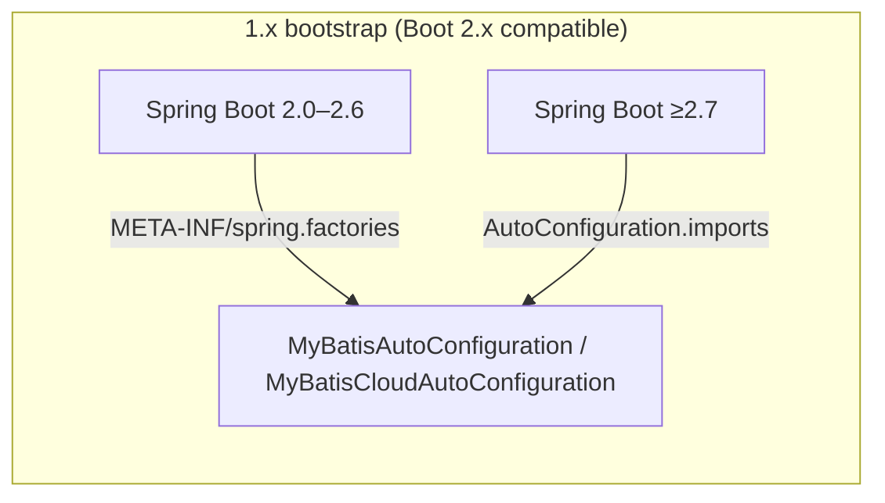

# Architecture — Microsphere MyBatis 0.1.x (`release-1.x`)

[中文](zh/architecture.md) · [← 1.x Index](README.md) · [Current architecture](../current/architecture.md)

The 1.x architecture is **the same design** as [`current`](../current/architecture.md):
identical module decomposition, identical dependency chain
(`utils → core → spring → spring-boot → spring-cloud`, `utils → test → spring-test`),
identical runtime interception pipeline (`InterceptingExecutorInterceptor` →
`InterceptingExecutor` → `ExecutorFilterChain` → `ExecutorFilter[]` →
`InterceptorsExecutorFilterAdapter` → `ExecutorInterceptor` callbacks), identical
optional-dependency policy.

Start from [the current architecture document](../current/architecture.md) — every diagram
there applies. This page records only what moves between the generations.

## What differs

### External dependency generation

```
┌─────────────────────────────────────────────────┐
│  1.x (0.1.x)                                    │
│  Java 8 baseline                                │
│  MyBatis 3.5.19 + mybatis-spring 2.1.2          │
│  mybatis-spring-boot-starter 2.1.2 (Boot 2.x)   │
│  Spring Cloud Hoxton – 2021.0.x                 │
│  microsphere-spring-cloud 0.1.26                │
└─────────────────────────────────────────────────┘
```

MyBatis' `Executor`, `Interceptor`, `Plugin` APIs are unchanged across these versions, so
the core module's interception design is generation-agnostic — confirmed by the six-file diff
in [the 1.x index](README.md).

### Auto-configuration discovery



`release` ships only `AutoConfiguration.imports`; `release-1.x` ships **both** registration
files so the same jar works on pre-2.7 and 2.7+ Boot. Details per module:
[spring-boot](spring-boot.md), [spring-cloud](spring-cloud.md).

### Language-level constraints in source

The Java 8 target forbids post-8 syntax, which is the sole reason the two `instanceof`
pattern-matching sites (`InterceptingExecutorInterceptor#plugin`,
`MyBatisTestExtension#close`) and the `Map#computeIfAbsent` call in `Plugins` look
different on this branch. Semantics are identical.

## See Also

- [current architecture](../current/architecture.md) — full diagrams (module graph, sequence flow)
- [user-guide 1.x compatibility matrix](../../user-guide/1.x/README.md)
