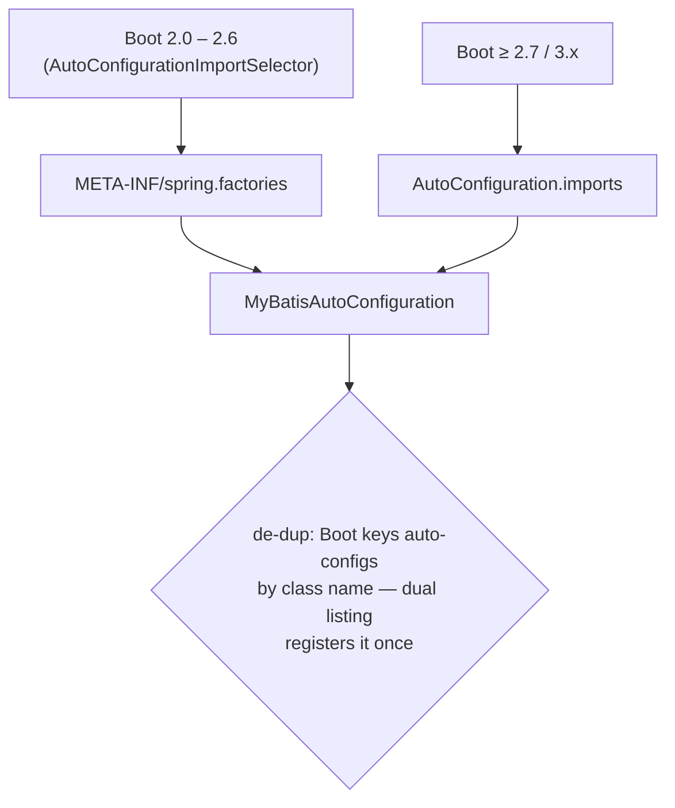

# microsphere-mybatis-spring-boot (1.x) — Developer Guide

[中文](zh/spring-boot.md) · [← 1.x Index](README.md) · [Current analysis](../current/spring-boot.md)

Same classes and annotations as `current` — `MyBatisAutoConfiguration` remains an empty shell
with `@ConditionalOnMyBatisAvailable` + `@EnableMyBatisExtension` +
`@AutoConfigureAfter(name=…)`; the composite conditions are unchanged.
Read [current/spring-boot.md](../current/spring-boot.md) for the full analysis.
The one difference is **how the class is discovered**.

## Registration diff

`release-1.x` ships **both** discovery files (verified on the branch):

```
META-INF/spring.factories
    org.springframework.boot.autoconfigure.EnableAutoConfiguration=\
    io.microsphere.mybatis.spring.boot.autoconfigure.MyBatisAutoConfiguration

META-INF/spring/org.springframework.boot.autoconfigure.AutoConfiguration.imports
    io.microsphere.mybatis.spring.boot.autoconfigure.MyBatisAutoConfiguration
```



Rationale: Spring Boot 2.7 introduced `AutoConfiguration.imports` and **deprecated** the
`EnableAutoConfiguration` key in `spring.factories` (removed in Boot 3). Shipping both files
lets one 0.1.x artifact serve the full supported window (Hoxton → 2021.0.x, Boot 2.1–2.6 in
practice) while remaining inert-but-harmless on newer Boot.

## Consequences when reading the current analysis

- Everything conditioned on class presence (`SqlSession`, `SqlSessionFactory`) works the
  same; the property switch `microsphere.mybatis.enabled` is unchanged.
- The `AutoConfigurationTest` contract test behaves identically — its conditions
  (`microsphere.mybatis.enabled`, missing classes) are generation-agnostic.

## See Also

- [spring-cloud 1.x](spring-cloud.md) — same dual-registration pattern
- [1.x differences overview](README.md)
- [User Guide](../../user-guide/1.x/spring-boot.md)
