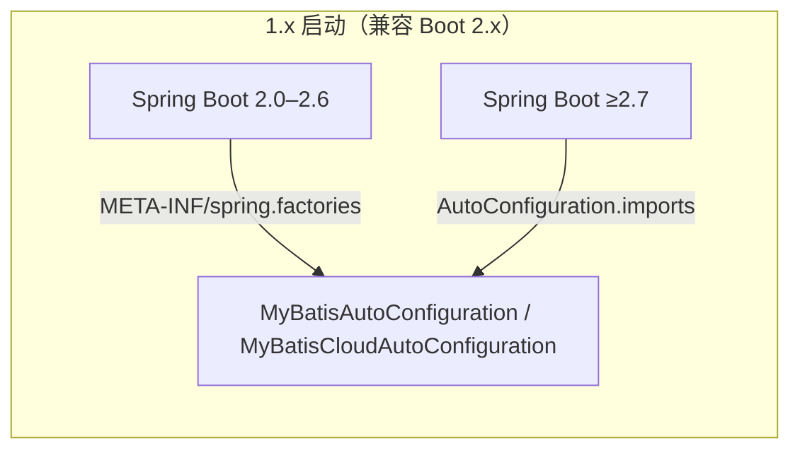

# 架构设计 —— Microsphere MyBatis 0.1.x（`release-1.x`）

[English](../architecture.md) · [← 1.x 索引](README.md) · [current 架构](../../current/zh/architecture.md)

1.x 的架构与 [`current`](../../current/zh/architecture.md) **设计完全一致**：模块划分相同，
依赖链相同（`utils → core → spring → spring-boot → spring-cloud`、
`utils → test → spring-test`），运行期拦截管线相同
（`InterceptingExecutorInterceptor` → `InterceptingExecutor` → `ExecutorFilterChain` →
`ExecutorFilter[]` → `InterceptorsExecutorFilterAdapter` → `ExecutorInterceptor` 回调），
optional 依赖策略相同。

请从 [current 架构文档](../../current/zh/architecture.md) 读起 —— 其中每张图都适用。
本页只记录代际之间的变化。

## 差异所在

### 外部依赖代际

```
┌─────────────────────────────────────────────────┐
│  1.x（0.1.x）                                   │
│  Java 8 基线                                    │
│  MyBatis 3.5.19 + mybatis-spring 2.1.2          │
│  mybatis-spring-boot-starter 2.1.2（Boot 2.x）  │
│  Spring Cloud Hoxton – 2021.0.x                 │
│  microsphere-spring-cloud 0.1.26                │
└─────────────────────────────────────────────────┘
```

MyBatis 的 `Executor`、`Interceptor`、`Plugin` API 在这些版本间没有变化，因此 core 模块的
拦截设计与代际无关 —— 六个文件的分支差异清单（见[1.x 索引](README.md)）证实了这一点。

### 自动配置发现机制



`release` 只带 `AutoConfiguration.imports`；`release-1.x` **两个**注册文件都带，让同一个
jar 在 2.7 之前与之后的 Boot 上都能工作。各模块细节见
[spring-boot](spring-boot.md)、[spring-cloud](spring-cloud.md)。

### 源码层面的语言级别约束

Java 8 目标禁用了 8 之后的语法，这就是本分支上两处 `instanceof` 模式匹配
（`InterceptingExecutorInterceptor#plugin`、`MyBatisTestExtension#close`）以及
`Plugins` 中 `Map#computeIfAbsent` 调用写法不同的唯一原因。语义完全一致。

## 另见

- [current 架构](../../current/zh/architecture.md) —— 完整图例（模块图、时序流）
- [用户文档 1.x 兼容矩阵](../../../user-guide/1.x/zh/README.md)
