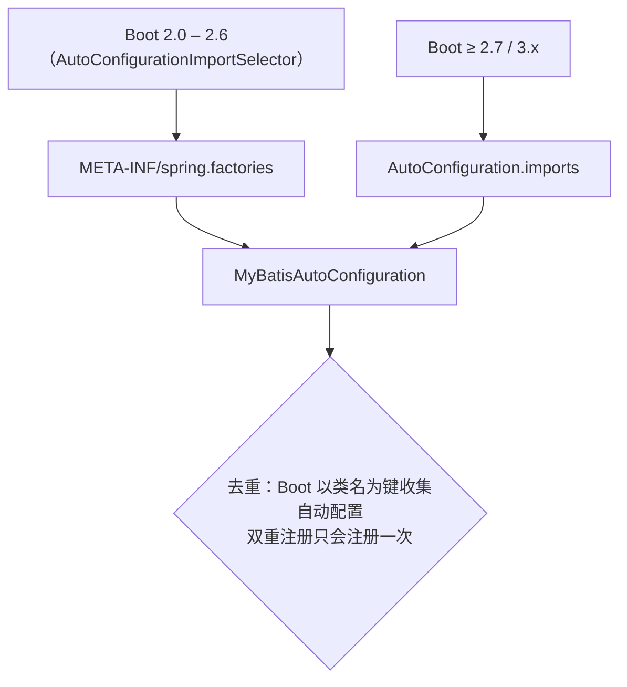

# microsphere-mybatis-spring-boot（1.x）—— 开发者文档

[English](../spring-boot.md) · [← 1.x 索引](README.md) · [current 源码分析](../../current/zh/spring-boot.md)

类与注解均与 `current` 相同 —— `MyBatisAutoConfiguration` 仍是空壳，携带
`@ConditionalOnMyBatisAvailable` + `@EnableMyBatisExtension` +
`@AutoConfigureAfter(name=…)`；组合条件注解不变。完整分析见
[current/spring-boot.md](../../current/zh/spring-boot.md)。唯一差异是**类的发现方式**。

## 注册差异

`release-1.x` 同时携带**两个**发现文件（已在分支上核实）：

```
META-INF/spring.factories
    org.springframework.boot.autoconfigure.EnableAutoConfiguration=\
    io.microsphere.mybatis.spring.boot.autoconfigure.MyBatisAutoConfiguration

META-INF/spring/org.springframework.boot.autoconfigure.AutoConfiguration.imports
    io.microsphere.mybatis.spring.boot.autoconfigure.MyBatisAutoConfiguration
```



动机：Spring Boot 2.7 引入 `AutoConfiguration.imports` 并**废弃**了
`spring.factories` 中的 `EnableAutoConfiguration` 键（Boot 3 移除）。同时携带两个文件，
让同一个 0.1.x 构件覆盖完整支持窗口（Hoxton → 2021.0.x，实践中为 Boot 2.1–2.6），
而在更新版本的 Boot 上也保持惰性且无害。

## 阅读 current 分析时的对应关系

- 以类存在为前提的条件（`SqlSession`、`SqlSessionFactory`）行为相同；属性开关
  `microsphere.mybatis.enabled` 不变。
- `AutoConfigurationTest` 契约测试行为一致 —— 其前提条件
  （`microsphere.mybatis.enabled`、类缺失）与代际无关。

## 另见

- [spring-cloud 1.x](spring-cloud.md) —— 相同的双重注册模式
- [1.x 差异总览](README.md)
- [用户文档](../../../user-guide/1.x/zh/spring-boot.md)
