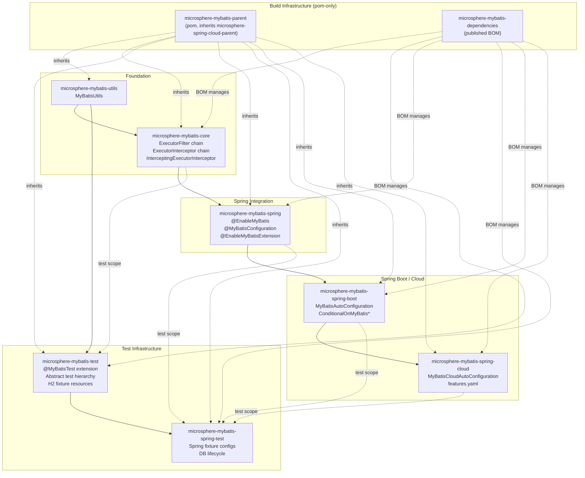
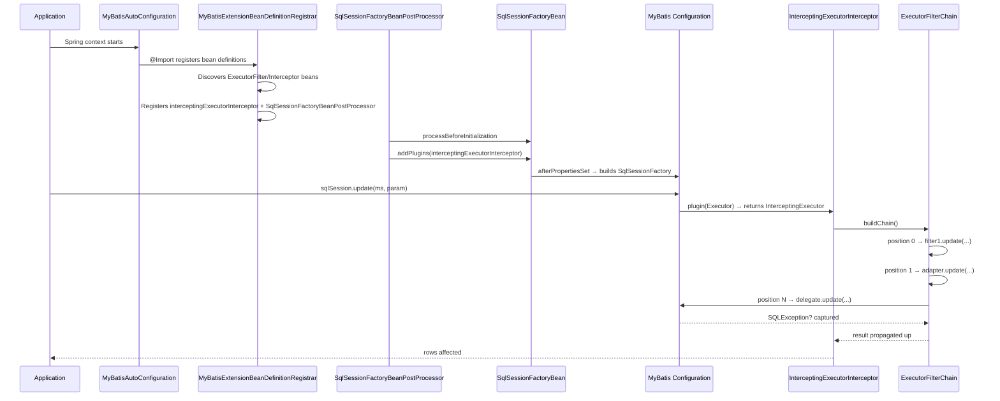

# Architecture Design — Microsphere MyBatis 0.2.x (`current`)

[中文](zh/architecture.md) · [← Developer Guide Index](../README.md) · [1.x](../1.x/architecture.md)

---

## Project Positioning

Microsphere MyBatis sits **between** the MyBatis framework and the Spring container.
It does not replace MyBatis — it adds an observable, chainable extension layer on top of
MyBatis' `Executor` interface, then integrates that layer into Spring's bean lifecycle.

```
┌──────────────────────────────────────────────────────────┐
│  Application (your code)                                 │
│  @SpringBootApplication  @Bean ExecutorFilter            │
├──────────────────────────────────────────────────────────┤
│  microsphere-mybatis-spring-cloud   (HasFeatures)        │
│  microsphere-mybatis-spring-boot    (AutoConfiguration)  │
│  microsphere-mybatis-spring         (@EnableMyBatis…)    │
├──────────────────────────────────────────────────────────┤
│  microsphere-mybatis-core         ExecutorFilter/Interceptor chain  │
│  microsphere-mybatis-utils        Bootstrap & template APIs         │
│  microsphere-mybatis-test         JUnit 5 extension & fixtures      │
│  microsphere-mybatis-spring-test  Spring fixture configs             │
├──────────────────────────────────────────────────────────┤
│  MyBatis 3.5.x   +   mybatis-spring 4.1.0   (optional deps)│
└──────────────────────────────────────────────────────────┘
```

---

## Module Dependency Graph (compile-time, non-optional edges)



Solid arrows = required compile-time dependency.  
Dotted arrows = optional / test-scope / build-time.

---

## External Dependency Strategy

All third-party and upstream-microsphere dependencies are declared **`optional`** in each module's
`pom.xml`. This means:

- The consumer's own BOM (`spring-boot-starter-parent`, `spring-cloud-dependencies`, etc.)
  controls the actual resolved versions.
- Microsphere MyBatis avoids version lock-in and can serve multiple Spring generations.
- The only *hard* compile-time requirement is internal cross-module edges
  (e.g. `core → utils`, `spring → core`).

The `microsphere-mybatis-parent` pom centralises the version properties (`mybatis.version`,
`mybatis-spring.version`, etc.) so that CI builds with different Spring Cloud profiles
(`spring-cloud-2022`, `spring-cloud-2023`, …) only need to activate a profile.

---

## End-to-End Execution Flow (Spring Boot application)



---

## Design Principles

1. **Non-intrusive extension** — the MyBatis plugin mechanism (`Interceptor.plugin(target)`) is
   used as the sole integration hook; no MyBatis or mybatis-spring class is subclassed or patched.
2. **Chain over proxy** — `ExecutorFilterChain` replaces MyBatis' single-proxy `Plugin` model with
   an explicit, composable chain; multiple `Interceptor` plugins can co-exist and merge.
3. **Observability without side effects** — `ExecutorInterceptor` callbacks are fire-and-forget:
   `InterceptorsExecutorFilterAdapter.iterate()` catches every `Throwable` and logs it at `warn`,
   guaranteeing that a broken audit/metrics callback cannot break the SQL path.
4. **Prioritized SPI** — both `ExecutorFilter` and `ExecutorInterceptor` extend
   `io.microsphere.lang.Prioritized`; the sort is stable and ascending.
5. **Test-first fixtures** — the test module ships its H2 config, mapper XMLs, init/destroy scripts
   as `src/main/resources` so that downstream modules and consumer tests reuse them without any
   `src/test/resources` setup.
6. **Version-line branching** — the Java-8 (`release-1.x`) and Java-17 (`release`/`main`) branches
   share the same design; only language features and auto-configuration registration files differ.

---

## Module Documentation Index

| Module | Developer Guide |
|---|---|
| [microsphere-mybatis-utils](utils.md) | Bootstrap utility class, `ThrowableConsumer` templates |
| [microsphere-mybatis-core](core.md) | Filter chain, adapter, `CachingExecutor` unwrapping |
| [microsphere-mybatis-test](test.md) | JUnit 5 extension lifecycle, resolver dependency graph |
| [microsphere-mybatis-spring](spring.md) | Registrar family, `SqlSessionFactoryBeanPostProcessor` |
| [microsphere-mybatis-spring-test](spring-test.md) | Event-driven database lifecycle |
| [microsphere-mybatis-spring-boot](spring-boot.md) | Auto-configuration ordering & conditions |
| [microsphere-mybatis-spring-cloud](spring-cloud.md) | `features.yaml` binding, `HasFeatures` beans |
| [parent & dependencies](parent-and-dependencies.md) | POM hierarchy, `${revision}` flatten, BOM scope |
