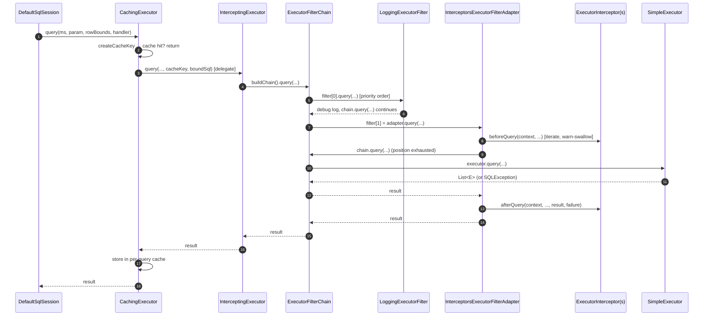

# microsphere-mybatis-core — Developer Guide (`current`)

[中文](zh/core.md) · [← Index](README.md) · [User Guide](../../user-guide/current/core.md)

The heart of the project. Three packages: `io.microsphere.mybatis.executor`,
`.plugin`, `.constants`.

## Architecture Design

The module converts MyBatis' *one proxy per Interceptor* plugin model into an *explicit chain of
filters* executed inside a decorator `Executor`, while remaining a perfectly ordinary MyBatis
`Interceptor` from the framework's point of view.

```mermaid
graph LR
    subgraph MyBatis
        SS[DefaultSqlSession] --> CE[CachingExecutor]
        CE --> SE[SimpleExecutor / Reuse / Batch]
    end
    subgraph microsphere-mybatis-core
        IEI[InterceptingExecutorInterceptor\nimplements org.apache.ibatis.plugin.Interceptor]
        IE[InterceptingExecutor\nimplements Executor]
        FC[ExecutorFilterChain]
        ADP[InterceptorsExecutorFilterAdapter\nimplements ExecutorFilter]
        F1[ExecutorFilter #1]
        FN[ExecutorFilter #N]
        I1[ExecutorInterceptor #1]
        IN[ExecutorInterceptor #N]
    end
    SS -->|plugin()| IEI -->|wraps| IE -->|buildChain| FC
    FC --> F1 --> FN --> ADP --> SE
    ADP --> I1
    ADP --> IN
```

## Source Analysis

### 1. Registration & wrapping: `InterceptingExecutorInterceptor.plugin(Object)`

`microsphere-mybatis-core/src/main/java/io/microsphere/mybatis/plugin/InterceptingExecutorInterceptor.java:134`

```java
if (target instanceof Executor executor) {
    boolean isCachingExecutor = executor instanceof CachingExecutor;
    Executor delegate = isCachingExecutor
        ? getDelegate((CachingExecutor) executor)   // reflection: CachingExecutor#delegate
        : executor;
    ...
    if (delegate instanceof InterceptingExecutor previous) {
        delegate = previous.getDelegate();                       // unwrap old wrapper
        // merge previous filters + properties into the new set  // idempotent re-registration
    }
    InterceptingExecutor interceptingExecutor = new InterceptingExecutor(delegate, newProperties, executorFilters);
    return isCachingExecutor ? new CachingExecutor(interceptingExecutor) : interceptingExecutor;
}
return target;   // ParameterHandler/ResultSetHandler/StatementHandler pass through untouched
```

Why unwrap the `CachingExecutor`: MyBatis builds `CachingExecutor(SimpleExecutor(...))` and then
applies plugins outer-first. If filters sat outside the cache, cached queries would never reach
them. Unwrapping places the `InterceptingExecutor` **between** cache and real executor, so
filters observe cache-miss executions only.

`intercept(Invocation)` deliberately does nothing (warn + `proceed()`): all work happens in
`plugin()`, so the interceptor needs no `@Intercepts`/`@Signature` annotation, and the JDK-proxy
`Plugin` path is never entered.

Constructor (`:80`) merges `ExecutorInterceptor...` into a single adapter element appended to the
filters array, then sorts the whole array with `PriorityComparator` (ascending
`Prioritized#getPriority`).

### 2. The decorator: `InterceptingExecutor`

`executor/InterceptingExecutor.java:60` implements `Executor` by delegation:

- Filtered operations (`update`, `query` ×2, `queryCursor`, `commit`, `rollback`,
  `createCacheKey`, `deferLoad`, `getTransaction`, `close`) build a **fresh**
  `ExecutorFilterChain` per call (`buildChain()`), making chains re-entrant and stateless.
- Unfiltered operations (`flushStatements`, `isCached`, `clearLocalCache`, `isClosed`) forward
  straight to the delegate — no per-invocation chain overhead on hot cache paths.
- `setExecutorWrapper(Executor)` re-wraps the new inner executor with this instance's
  properties and filters (guarding against double-wrap), preserving the chain when MyBatis'
  `BaseExecutor` rebuilds its wrapper.

### 3. Chain mechanics: `ExecutorFilterChain.process(...)`

`executor/ExecutorFilterChain.java:307` — the core of the Chain-of-Responsibility:

```java
if (position < size) {
    result = filterFunction.apply(filters[position++]);   // next filter
} else {
    result = executorFunction.apply(this.executor);        // real Executor
}
```

Exception policy is split by method family:

| Family | Checked-exception handling |
|---|---|
| `applySQL` / `consumeSQL` (SQL ops) | `ExceptionUtils.wrap(e, SQLException.class)` — SQL failures stay `SQLException` |
| `apply` / `consume` (non-SQL ops) | wrapped as `RuntimeException` |

The mutable `position` field is safe because a new chain instance is built for each invocation.

### 4. Adapter & error isolation: `InterceptorsExecutorFilterAdapter`

`executor/InterceptorsExecutorFilterAdapter.java:65` implements `ExecutorFilter`; every method
follows the same shape (shown for `update`, `:92`):

```java
InterceptorContext<Executor> context = buildContext(chain);
beforeUpdate(context, ms, parameter);
try {
    result = chain.update(ms, parameter);
} catch (SQLException e) {
    failure = e; throw e;
} finally {
    afterUpdate(context, ms, parameter, result, failure);
}
```

- `buildContext` = `new InterceptorContext<>(chain.getExecutor(), chain.getProperties())` —
  one context per **operation**, shared by all interceptors for that operation (their
  attributes cross-pollinate; each gets fresh timing state).
- `iterate(Consumer)` (`:338`) wraps every interceptor callback in try/catch `Throwable` +
  `logger.warn` — the fire-and-forget guarantee.
- Interceptor arrays are sorted by priority at construction (`:88`).

### 5. Signature utilities: `Plugins`

`plugin/Plugins.java` reimplements MyBatis' `Plugin.getSignatureMap` with **stricter validation**:
`@Signature#type` outside `{Executor, ParameterHandler, ResultSetHandler, StatementHandler}`
throws `PluginException` (`:112`), and `getPlugin(proxy)` (`:133`) recognises MyBatis' JDK
proxies by inspecting the `InvocationHandler` for `Plugin`. On the 0.2.x line it uses
`Map#computeIfAbsent`; the 1.x line uses MyBatis' internal `MapUtil.computeIfAbsent` — the only
substantive code diff between branches.

### 6. Constants: `PropertyConstants`

Defines `microsphere.mybatis.enabled` (`:64`), annotated
`@ConfigurationProperty(type = boolean.class, defaultValue = "true", source = APPLICATION_SOURCE)`
— consumed by the Spring Boot module's `@ConditionalOnProperty` and exported for IDE metadata.

## Complex Flow: one `sqlSession.selectList(...)` through the layers



## Design Patterns

| Pattern | Class(es) | Notes |
|---|---|---|
| Chain of Responsibility | `ExecutorFilterChain` + `ExecutorFilter` | index-cursor chain, fresh instance per call |
| Decorator | `InterceptingExecutor` | adds chain behaviour to any `Executor` without changing its type |
| Adapter | `InterceptorsExecutorFilterAdapter` | N interceptors → 1 filter; bridges two extension styles |
| Observer (pair callbacks) | `ExecutorInterceptor` | `beforeXxx`/`afterXxx` with result+failure payload |
| Proxy (framework-side) | MyBatis `Plugin` | deliberately avoided — `plugin()` returns the concrete decorator instead of a JDK proxy |
| Flyweight-ish context | `InterceptorContext` | one per operation, shared across interceptors |
| Template Method | `ExecutorFilterChain.apply/consume(…SQL)` families | fixed exception policy, pluggable lambdas |
| Strategy | filter arrays per plugin registration | composition decides behaviour, sorted by `Prioritized` |

## Testing Approach

The `core` module tests (`InterceptingExecutorInterceptorTest` etc.) extend
`AbstractMapperTest` from the test module — real H2 execution, no mocks. Negative cases use
`ThrowingErrorExecutorFilter/Interceptor` + `runSafely(...)` to prove the error-isolation
guarantees: an `Executor` operation must still surface its own `SQLException` while all
interceptor failures are swallowed.

## See Also

- [spring module analysis](spring.md) — how the plugin gets into a Spring-built factory
- [test module analysis](test.md)
- [1.x differences](../1.x/core.md)
