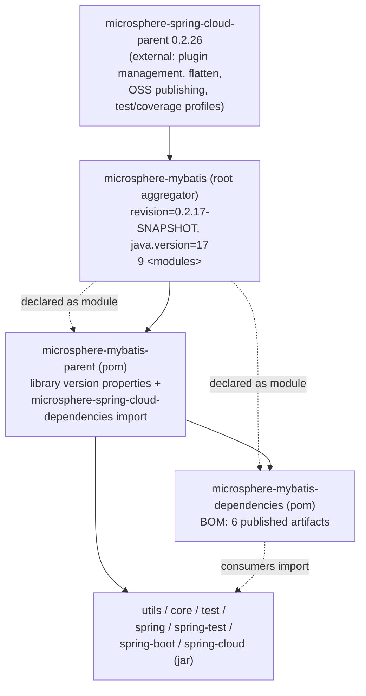
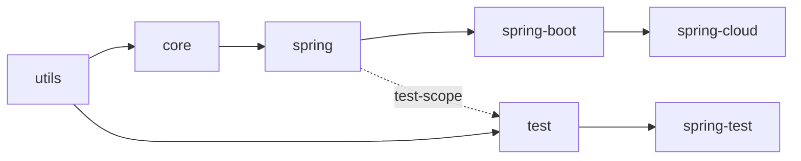

# Parent & Dependencies POMs — Developer Guide (`current`)

[中文](zh/parent-and-dependencies.md) · [← Index](README.md) · [User Guide](../../user-guide/current/parent-and-dependencies.md)

Three non-code POMs carry the build: the root aggregator, the internal parent
(`microsphere-mybatis-parent`), and the published BOM (`microsphere-mybatis-dependencies`).

## POM inheritance

Key points from the POM sources:

- The root POM's **only** parent is `microsphere-spring-cloud-parent` (an external,
  cross-repo parent). Build plugins, publishing config, and the `test` / `coverage` /
  `spring-cloud-*` Maven profiles all come from there — this repo defines none of them.
- `microsphere-mybatis-parent` is the parent of every jar module **and** of the BOM; it pins
  the library generations:

  | Property | Value |
  |---|---|
  | `microsphere-spring-cloud.version` | `0.2.26` (imported as `microsphere-spring-cloud-dependencies` BOM) |
  | `mybatis.version` | `3.5.19` |
  | `mybatis-spring.version` | `4.1.0` |
  | `mybatis-spring-boot.version` | `3.0.5` (starter) |
  | `cglib.version` | `3.3.0` |

- Version is `${revision}` everywhere, defined once in the root POM
  (`0.2.17-SNAPSHOT` on `release`). The external parent applies **flatten-maven-plugin**, so
  published POMs resolve `${revision}` (and resolve imported BOMs) into concrete values —
  CI overrides it with `-Drevision=0.0.1-SNAPSHOT` to avoid publishing collisions.

## Internal module dependency chain

- Compile edges are the hard chain: `utils → core → spring → spring-boot → spring-cloud` and
  `utils → test → spring-test`.
- **Every upstream library dependency in every module is `<optional>true</optional>`**
  (MyBatis, mybatis-spring, Spring, Spring Boot, Spring Cloud, microsphere-spring-*). Consumers
  must bring their own MyBatis/Spring versions; nothing is force-transitively pulled.
- Internal edges use `<version>${revision}</version>` rather than BOM imports — the BOM is for
  third-party consumers, not for the reactor build.

## BOM scope quirk

`microsphere-mybatis-dependencies` manages exactly six artifacts: `core`, `test`, `spring`,
`spring-test`, `spring-boot`, `spring-cloud`.

**`microsphere-mybatis-utils` is missing from the BOM**, so consumers that import the BOM and
depend on utils must write an explicit version. (Verified against the POM on `release`; treat
as a gap, not a design decision.)

## CI matrix

`.github/workflows/maven-build.yml` builds the reactor on `main`/`dev`/`release` pushes with:

- `java: [17, 21, 25]` (temurin)
- `maven-profile-spring-cloud: [spring-cloud-2022, spring-cloud-2023, spring-cloud-2024, spring-cloud-2025]`
  — i.e. 3 × 4 = 12 combinations, each running `mvn --activate-profiles test,coverage,<profile>
  -Drevision=0.0.1-SNAPSHOT`.

This is the enforced statement of the compatibility range documented in the
[user guide](../../user-guide/README.md): 0.2.x supports Spring Cloud 2022.0.x – 2025.0.x.

## See Also

- [architecture overview](architecture.md) — module roles
- [1.x differences](../1.x/parent-and-dependencies.md) — 0.1.x POM generation (Java 8, mybatis-spring 2.1.2)
