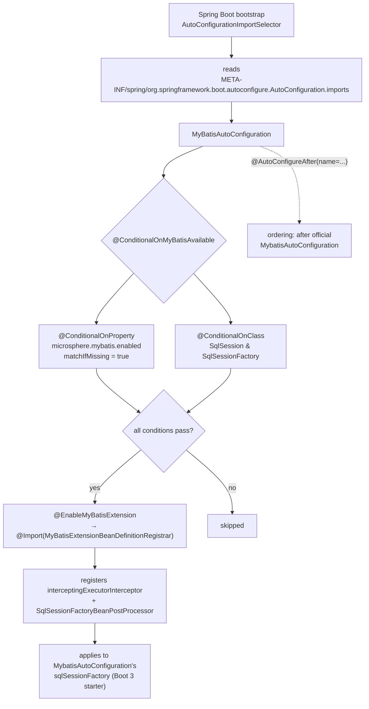

# microsphere-mybatis-spring-boot — Developer Guide (`current`)

[中文](zh/spring-boot.md) · [← Index](README.md) · [User Guide](../../user-guide/current/spring-boot.md)

Three classes: an empty auto-configuration shell, and two composite condition annotations.
All real work is delegated to the [spring module](spring.md).

## Architecture Design



## Source Analysis

### `MyBatisAutoConfiguration`

```java
@ConditionalOnMyBatisAvailable
@EnableMyBatisExtension
@AutoConfigureAfter(name = {"org.mybatis.spring.boot.autoconfigure.MybatisAutoConfiguration"})
public class MyBatisAutoConfiguration { }
```

- **Empty body.** Being listed in `AutoConfiguration.imports` makes it a configuration class;
  `@EnableMyBatisExtension`'s meta-`@Import` is what actually registers the registrar.
- `@AutoConfigureAfter` uses the **`name`** attribute (string class names), so the class compiles
  and runs even when `mybatis-spring-boot-autoconfigure` is absent — it just no-ops via the
  conditions. Using `value` would create a hard compile-time reference.
- Ordering matters: the official `MybatisAutoConfiguration` creates `sqlSessionFactory`; ours
  must register the `BeanPostProcessor` **before** that bean is initialized so the plugin lands
  in `SqlSessionFactoryBean#plugins` pre-`afterPropertiesSet`. `@AutoConfigureAfter` guarantees
  the auto-config phase order; the post-processor order within the context refresh takes care
  of the rest.

### Conditions

```java
@ConditionalOnMyBatisEnabled                        // @ConditionalOnProperty(name = MICROSPHERE_MYBATIS_ENABLED_PROPERTY_NAME, matchIfMissing = true)
@ConditionalOnClass(name = {"org.apache.ibatis.session.SqlSession",
                            "org.apache.ibatis.session.SqlSessionFactory"})
public @interface ConditionalOnMyBatisAvailable { }
```

Both are **composite annotations** (meta-annotations), an established Spring Boot idiom that keeps
`@Conditional...` declarative and reusable. The property constant is imported from
`io.microsphere.mybatis.constants.PropertyConstants` (core module) — one source of truth
shared with the spring-cloud module.

`matchIfMissing = true` ⇒ default-on; the `ConditionalOnMyBatisEnabledTest` pins both directions.

### Test architecture

`MyBatisAutoConfigurationTest extends AutoConfigurationTest<MyBatisAutoConfiguration>`
(microsphere-spring-boot-test) — an external base class with three inherited tests
(auto-configured / globally disabled / missing class) that subclasses parameterize by overriding
`configureAutoConfiguredClasses`, `configureGlobalDisabledPropertyValues`,
`configureGlobalMissingClasses`. The override here adds `InterceptingExecutorInterceptor.class`
as an expected source-registered class — a contract test of the registrar's output.

## Design Patterns

| Pattern | Where |
|---|---|
| Composite Condition | `@ConditionalOnMyBatisAvailable` = Enabled ∧ OnClass |
| Auto-Configuration + ordering constraint | `AutoConfiguration.imports` + `@AutoConfigureAfter(name=…)` |
| Null Object shell | empty configuration class — behaviour entirely via meta-annotations |
| Contract test base | `AutoConfigurationTest<T>` template |

## Known Limitations

- Only the Executor extension is auto-configured; `sqlSessionFactory`/`sqlSessionTemplate`
  remain the official starter's job (by design, to avoid config-namespace collisions).
- No `@ConfigurationProperties` class exists; `microsphere.mybatis.enabled` is the sole knob —
  customization happens by declaring filter/interceptor beans.

## See Also

- [spring-cloud analysis](spring-cloud.md) — depends on this module
- [1.x differences](../1.x/spring-boot.md) — `spring.factories` registration
