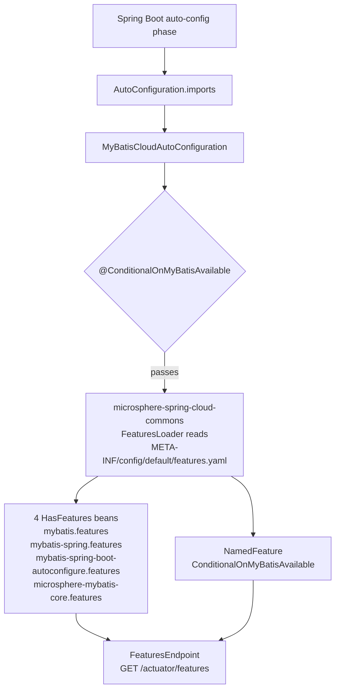

# microsphere-mybatis-spring-cloud — Developer Guide (`current`)

[中文](zh/spring-cloud.md) · [← Index](README.md) · [User Guide](../../user-guide/current/spring-cloud.md)

The observability tail of the dependency chain: one empty auto-configuration class whose only
job is to activate a static `features.yaml`, so MyBatis technology stacks show up under the
Spring Cloud `/actuator/features` endpoint.

## Architecture Design



Unlike the [spring-boot module](spring-boot.md), this auto-configuration class carries **no
`@EnableMyBatisExtension`** — it registers no functional beans. Everything it "does" is
declarative metadata published through the classpath resource.

## Source Analysis

### `MyBatisCloudAutoConfiguration`

```java
@ConditionalOnMyBatisAvailable
@AutoConfigureAfter(name = {"org.mybatis.spring.boot.autoconfigure.MybatisAutoConfiguration"})
public class MyBatisCloudAutoConfiguration { }
```

- Reuses `@ConditionalOnMyBatisAvailable` from the spring-boot module, so one switch
  (`microsphere.mybatis.enabled`, default `true`) disables both the Executor extension and the
  feature publishing.
- The `@AutoConfigureAfter(name=…)` ordering mirrors the boot module's and again uses the
  string `name` attribute to avoid a compile-time dependency on the optional MyBatis starter.

### `META-INF/config/default/features.yaml`

The file is consumed by microsphere-spring-cloud's features infrastructure
(`spring.cloud.features.enabled=true` at runtime). Two sections:

- **`abstract:`** four groups of class names, each becoming one `HasFeatures` bean —
  a group is reported only when its classes are on the classpath:
  | Group | Entries | Content |
  |---|---|---|
  | `mybatis` | 19 | core SPI types: `Executor`, `Interceptor`, `TypeHandler`, `LanguageDriver`, `DatabaseIdProvider`, `DataSourceFactory`, `SqlSessionFactory`, `TransactionFactory`, `Configuration`, `Cache`, `KeyGenerator`, `ProxyFactory`, `ParameterHandler`, `ResultContext`, `ResultSetHandler`, `StatementHandler`, `ResultHandler`, `SqlSource`, `ReflectorFactory` |
  | `mybatis-spring` | 6 | `SqlSessionTemplate`, `MapperFactoryBean`, `MapperScannerConfigurer`, `MapperScannerBeanDefinitionParser`, `SqlSessionFactoryBean`, `SpringManagedTransactionFactory` |
  | `mybatis-spring-boot-autoconfigure` | 3 | `MybatisProperties`, `ConfigurationCustomizer`, `SqlSessionFactoryBeanCustomizer` |
  | `microsphere-mybatis-core` | 2 | `ExecutorFilter`, `ExecutorInterceptor` |
- **`named:`** one `NamedFeature` (`ConditionalOnMyBatisAvailable` → its annotation type),
  exposing the conditional as a named feature entry.

The `microsphere-mybatis-core` group is the interesting one: it reports the project's own
extension SPI, so operators can confirm the filtering/interception stack is actually deployed.

### POM dependency shape

Everything upstream is `optional` (`microsphere-spring-cloud-commons`, `spring-cloud-commons`,
`spring-boot-starter`, actuator, the MyBatis artifacts). The compile chain is exactly one edge:
`microsphere-mybatis-spring-boot`.

## Testing

Two layers:

- `MyBatisCloudAutoConfigurationTest extends AutoConfigurationTest<…>` — contract test of the
  conditions: no auto-configured classes expected (empty body), global disable via
  `microsphere.mybatis.enabled=false`, missing classes `SqlSession`/`SqlSessionFactory`.
- `MyBatisCloudAutoConfigurationIntegrationTest` — a real `@SpringBootTest` with
  `@EnableAutoConfiguration` and `spring.cloud.features.enabled=true`; asserts the four
  `HasFeatures` beans (`mybatis.features`, `mybatis-spring.features`,
  `mybatis-spring-boot-autoconfigure.features`, `microsphere-mybatis-core.features`) and a
  non-null `FeaturesEndpoint#features()` payload. It also registers `LoggingExecutorFilter` /
  `LoggingExecutorInterceptor` as beans so the spring module's extension path is exercised
  end-to-end.

## Design Patterns

| Pattern | Where |
|---|---|
| Declarative metadata over code | entire module: one YAML file replaces any feature-registration logic |
| Composite Condition reuse | `@ConditionalOnMyBatisAvailable` shared with spring-boot module |
| Classpath-introspection report | `HasFeatures` groups gated by class presence |

## Known Limitations

- `microsphere-mybatis-spring-test` is declared **without `<scope>test</scope>`** in this
  module's pom, so it leaks as a compile-scope transitive dependency to consumers. It works
  (the integration tests depend on it) but looks unintended — consumers should exclude it or
  pin their own version.
- Features are static: adding a new group means editing `features.yaml`, not extending code.

## See Also

- [spring-boot analysis](spring-boot.md) — where the shared condition annotation lives
- [parent & dependencies](parent-and-dependencies.md) — how optional-dependency policy is enforced
- [1.x differences](../1.x/spring-cloud.md) — `spring.factories` registration
