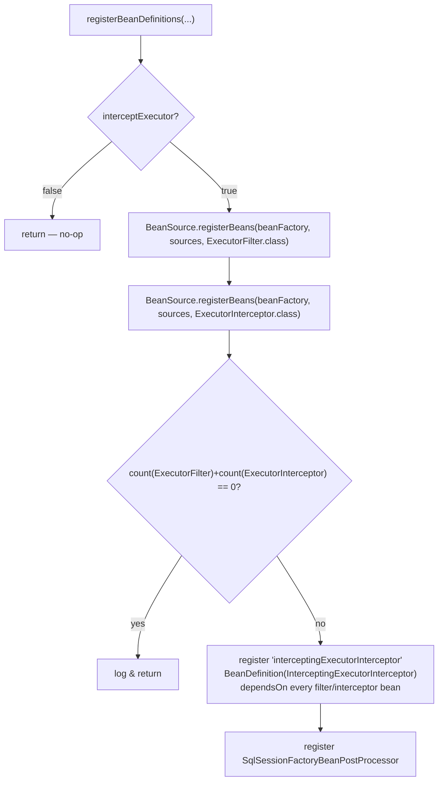

# microsphere-mybatis-spring — Developer Guide (`current`)

[中文](zh/spring.md) · [← Index](README.md) · [User Guide](../../user-guide/current/spring.md)

Eight classes, one package (`io.microsphere.mybatis.spring.annotation`): three annotations + a
registrar family + one bean post-processor. The module translates annotation attributes into
Spring `BeanDefinition`s — no beans are instantiated at parse time.

## Architecture Design

```mermaid
graph TD
    EM["@EnableMyBatis"] -->|@Import| MBDR[MyBatisBeanDefinitionRegistrar]
    EMC["@MyBatisConfiguration"] -->|@Import| MCBDR[MyBatisConfigurationBeanDefintionRegistrar]
    EME["@EnableMyBatisExtension"] -->|@Import| MEIBDR[MyBatisExtensionBeanDefinitionRegistrar]
    BASE[MyBatisImportBeanDefinitionRegistrar<A extends Annotation>\npackage-private abstract base] --> MBDR & MCBDR & MEIBDR
    ABC["AnnotatedBeanCapableImportBeanDefinitionRegistrar\n(from microsphere-spring-context)"] --> BASE
    MEIBDR -->|registers| IEI["bean: interceptingExecutorInterceptor"]
    MEIBDR -->|registers| BPP[SqlSessionFactoryBeanPostProcessor]
    BPP -->|addPlugins| SFB["SqlSessionFactoryBean\n(from @EnableMyBatis or official starter)"]
    MBDR -->|registers| SF["bean: sqlSessionFactory (SqlSessionFactoryBean)"]
    MBDR -->|registers| ST["bean: sqlSessionTemplate"]
    MCBDR -->|registers| CFG["bean: configuration (MyBatis Configuration)"]
```

## Source Analysis

### 1. Shared base: `MyBatisImportBeanDefinitionRegistrar`

Entry template lives upstream in microsphere-spring-context:
`registerBeanDefinitions(metadata, registry, generator)` is **final** — it checks
`isEnabled(metadata)` (the `microsphere.mybatis.enabled`-style gate), resolves
`ResolvablePlaceholderAnnotationAttributes` (so `${...}` inside annotation values is expanded
against the Spring `Environment` **before** bean-definition creation), then calls the subclass
hook. Helpers provided to subclasses:

| Helper | Behaviour |
|---|---|
| `registerBeanDefinitionIfAbsent(...)` | first-registration wins — an existing `sqlSessionFactory` bean is skipped with an `INFO` log |
| `stringArrayToProperties(String[])` | each entry must contain exactly one `=` (trimmed key/value); otherwise `IllegalArgumentException` — drives `InvalidConfigurationPropertiesTest` |
| `setBeanReferencePropertyValue(...)` | blank ⇒ skip; `"*"` ⇒ `findTargetBeanName(type)` (primary wins among many); literal ⇒ `RuntimeBeanReference` |
| `setPropertyValue(builder, attributes, name, default)` | skips values equal to the annotation default ⇒ lean bean definitions |
| `setPackagePropertyValue(...)` | multi-package joined by line separator (MyBatis convention) |

### 2. `MyBatisBeanDefinitionRegistrar` (`@EnableMyBatis`)

Builds a `BeanDefinitionBuilder.genericBeanDefinition(SqlSessionFactoryBean.class)` populated
entirely from annotation attributes (`dataSource` ref, `configLocation` or a `configuration`
bean **reference**, `mapperLocations`, `typeAliasesPackage`, `configurationProperties` as
`Properties`, `plugins`/`typeHandlers`/`scriptingLanguageDrivers` as bean refs, …). When
`configLocation` is blank, the registrar wires the annotation-configured `configuration` bean
instead — this is the `@MyBatisConfiguration` ↔ `@EnableMyBatis` interlock.
`sqlSessionTemplate` is registered with constructor args `(sqlSessionFactory ref, executorType)`.
`checkConfigLocation=true` asserts resource existence **during registration**, failing fast
before any bean instantiation.

### 3. `MyBatisConfigurationBeanDefintionRegistrar` (`@MyBatisConfiguration`)

(Class name contains a historical typo "Defintion"; package-private, not user-facing.)
Mechanical copy of ~34 annotation attributes onto a `Configuration` bean definition with three
conversions: `lazyLoadTriggerMethods` `String[]`→`Set`, `variables` `String[]`→`Properties`,
and `proxyFactory` `Class`→ **instance** (a `RuntimeBeanValue` would fail; instantiation fix
shipped in 0.2.15 / mirrored in 0.1.16). Defaults are skipped, so MyBatis' own defaults survive.

### 4. `MyBatisExtensionBeanDefinitionRegistrar` (`@EnableMyBatisExtension`)



`BeanSource` semantics (from microsphere-spring-context): `BEAN_FACTORY` only *queries* existing
definitions; `SPRING_FACTORIES` loads **classes** from `META-INF/spring.factories` keyed by the
interface name and registers them; `JAVA_SERVICE_PROVIDER` does the same via `ServiceLoader`.
Registered-by-class beans get name-generated registrations (`loggingExecutorFilter#0`-style or
simple name, per `BeanRegistrar`).

### 5. `SqlSessionFactoryBeanPostProcessor`

Package-private, `extends GenericBeanPostProcessorAdapter<SqlSessionFactoryBean>`, constructor-
injected with the interceptor bean. `processBeforeInitialization`:

```java
Interceptor[] plugins = getFieldValue(true, bean, "plugins");   // reflect SqlSessionFactoryBean#plugins
if (contains(plugins, this.interceptingExecutorInterceptor)) return;   // @EnableMyBatis(plugins=...) already covered it
bean.addPlugins(this.interceptingExecutorInterceptor);
```

Because it runs **before** `afterPropertiesSet()`, the plugin participates in the normal
`Configuration.addInterceptor` fan-out that builds every session's executor — one post-processor,
all factories, no XML edits.

## Notable Flows

**`@EnableMyBatis` + `@MyBatisConfiguration` composition:** `MapperConfig2` in
`EnableMyBatisTest` combines both — the `configuration` bean definition is produced by the
`@MyBatisConfiguration` registrar; `MyBatisBeanDefinitionRegistrar` detects the blank
`configLocation` and emits `<property name="configuration" ref="configuration"/>`, so runtime
wiring is a bean **reference**, not a copy.

**Multiple datasources:** `MultipleDataSourceConfig` test shows `dataSource = "*"` picks the
primary; naming explicitly always wins.

## Design Patterns

| Pattern | Where |
|---|---|
| Registrar family / "Front Controller" per annotation | shared base + three concrete `ImportBeanDefinitionRegistrar`s |
| Template Method | final `registerBeanDefinitions` in the upstream base, subclass hooks |
| Data Mapper (annotation → BeanDefinition) | attribute-by-attribute property mapping with default elision |
| Placeholder strategy | `"*"`/blank/name conventions for bean references |
| Bean Post-Processor | `SqlSessionFactoryBeanPostProcessor` |
| Lazy interlock | `@MyBatisConfiguration` and `configLocation` choose at registration time, no runtime branching |

## Testing Approach

`EnableMyBatisTest` / `EnableMyBatisExtensionTest` use `SpringTestUtils.testInSpringContainer`
(programmatic `AnnotationConfigApplicationContext`) over 10+ nested config classes, each pinning
one attribute combination; `src/test/resources/META-INF/spring.factories` and
`META-INF/services/...` fixtures exercise the two SPI discovery sources.

## See Also

- [spring-boot analysis](spring-boot.md) — how auto-config reuses these registrars
- [User Guide](../../user-guide/current/spring.md) — full attribute tables
