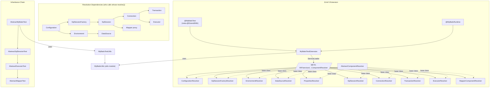
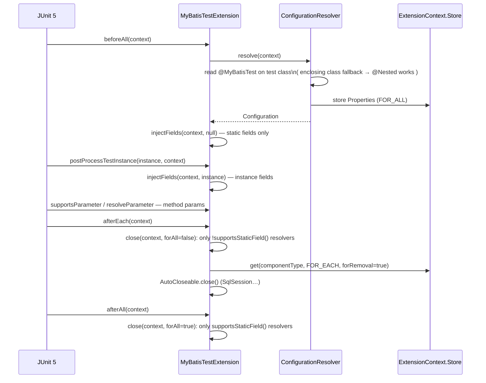

# microsphere-mybatis-test — Developer Guide (`current`)

[中文](zh/test.md) · [← Index](README.md) · [User Guide](../../user-guide/current/test.md)

Two cooperating subsystems: an abstract-test inheritance chain, and a JUnit 5 extension built
on a resolver SPI. Fixtures (config XML, mappers, SQL scripts) ship as **main** resources so
every downstream module and consumer test can reuse them.

## Architecture Design



## Source Analysis

### 1. Extension lifecycle (`MyBatisTestExtension.java`)

```java
public class MyBatisTestExtension implements BeforeAllCallback, AfterAllCallback,
        AfterEachCallback, TestInstancePostProcessor, ParameterResolver
```

Notable: **no `BeforeEachCallback`** — instance-field injection piggybacks on
`postProcessTestInstance`, which JUnit guarantees once per test instance (works for both
`PER_CLASS` and `PER_METHOD` lifecycle).



Injection rule (`injectFields`): every declared field (walking up the hierarchy via
`findAllDeclaredFields`) matching the static/non-static predicate, whose resolver returns a
non-`null` component, is written with `FieldUtils.setFieldValue(true, ...)` (force-accessible).
A field for which no resolver claims the type stays untouched — `@MyBatisRuntime` on a
`String` field is silently `null`, not an error (see `StaticFieldTests` asserting
`assertNull(sqlSession)` for unsupported static targets).

### 2. Resolver SPI

`ComponentResolver<T>` — three decision points:

| Method | Purpose |
|---|---|
| `supportsParameter(ParameterContext, ExtensionContext)` | default: `@MyBatisRuntime` present **and** `isComponentType(...)` |
| `supportsField(ExtensionContext, Field)` | same, plus static fields require `supportsStaticField()` |
| `resolve(ExtensionContext, Class)` | produce (and cache) the component |

`AbstractComponentResolver<T>` derives `componentType` reflectively
(`from(getClass()).as(ComponentResolver.class).getGenericType(0)`), and its **final**
`resolve(...)` implements: store-lookup → `doResolve(...)` → write to FOR_ALL (if static-capable)
→ always write to FOR_EACH.

Caching subtlety: `store(...)` keys on `component.getClass()` while `get(...)` looks up the
**declared** type. For interface-typed components (`DefaultSqlSession`, `PooledDataSource`,
`JdbcTransaction`, `SimpleExecutor`, mapper `$Proxy`) the keys never match, so those are
re-created per lookup — which is precisely why per-test resources are closed via
`afterEach` and never shared across tests. `Properties`/`Configuration`/`Environment`
(single concrete type) do cache in FOR_ALL.

`MapperComponentResolver` is the odd one out: `getComponentType()` is `Object`, and instead of
equality it overrides `isComponentType` to consult
`Configuration#getMapperRegistry().getMappers()` — any registered mapper interface routes here.

### 3. Abstract hierarchy

`AbstractMyBatisTest.init()` (`@BeforeEach`):
`MyBatisTestUtils.buildDefaultSqlSessionFactory()` → `customize(SqlSessionFactory)` →
`customize(Configuration)` → `runScript(INIT_DB_SCRIPT_RESOURCE_NAME)`.
`destroy()` (`@AfterEach`) runs the destroy script. Each subclass adds exactly one `@Test`,
so extending `AbstractMapperTest` replays the whole ladder (`testSqlSession`, `testExecutor`,
`testMapper`). `AbstractMapperTest.testMapper()` first calls
`getConfiguration().setCacheEnabled(false)` because `UserMapper.xml` declares a second-level
`<cache/>` that would poison repeat-read assertions.

### 4. Fixtures

`init-db.sql` seeds deterministic rows (father#1 `John Smith`, children#1/2) that
`assertChildMapper`/`assertFatherMapper` rely on. `UserMapper.getErrorUserByName` references a
non-existent `error_users` table **on purpose** — negative-path tests for the interceptor chain
(`runSafely(() -> userMapper.getErrorUserByName("testing"))`).

## Design Patterns

| Pattern | Where |
|---|---|
| Template Method | abstract hierarchy (`customize`, `doIn*`, inherited `@Test` methods) |
| Strategy + Registry | `ComponentResolver` list, first-match wins by ServiceLoader order |
| Service Provider (SPI) | `META-INF/services/...ComponentResolver` — third parties can add resolvers |
| Factory Method | `resolve`/`doResolve` pairs |
| Marker Annotation | `@MyBatisRuntime` |
| Object Mother | `createUser()`, entity/mapper fixtures |

## Extension Points

- Add a resolver: implement `AbstractComponentResolver<X>`, append the class name to the
  services file (your jar's copy aggregates via `ServiceLoader`).
- Custom fixtures: declare your own `@MyBatisTest(configResource = "...", environment = "...")`.

## See Also

- [spring-test analysis](spring-test.md)
- [User Guide](../../user-guide/current/test.md) — attribute tables & usage snippets
