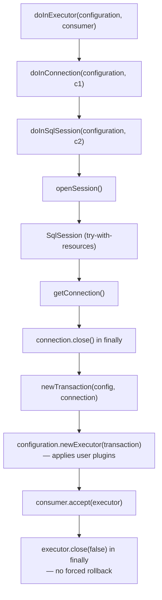

# microsphere-mybatis-utils — Developer Guide (`current`)

[中文](zh/utils.md) · [← Index](README.md) · [User Guide](../../user-guide/current/utils.md)

Single class module: `io.microsphere.mybatis.util.MyBatisUtils` (`microsphere-mybatis-utils/src/main/java/io/microsphere/mybatis/util/MyBatisUtils.java`).

## Architecture Role

The lowest layer of the repository. It encapsulates every "first contact" with MyBatis
(`XMLConfigBuilder`, `DefaultSqlSessionFactory`, `ScriptRunner`, `TransactionFactory`) behind a
stateless, exception-transparent API, so that `core`, `test` and all Spring modules never touch
MyBatis builders directly.

Maven: depends only on MyBatis (optional) + `microsphere-java-core` (for `ThrowableConsumer`,
`@Nonnull`). Not managed in the published BOM — consumers reach it transitively via `core`.

## Source Analysis

### Class shape

```java
public abstract class MyBatisUtils {   // abstract + private ctor = non-instantiable utility
    private MyBatisUtils() { }
}
```

The class is `abstract` rather than `final` — a microsphere house style shared with
`Executors`, `Plugins`, `MyBatisTestUtils`. It also permits `@Nonnull` overrides in subclasses
should the API ever need specialization.

### Configuration bootstrap

`getConfiguration(configResource, environment, properties)` is the only parsing entry point;
the two shorter overloads delegate to it with `null`s. It wraps MyBatis'
`XMLConfigBuilder` in try-with-resources around `Resources.getResourceAsReader(...)`, which:

- resolves the resource through MyBatis' classloader cascade (thread context → system → own),
- guarantees the `Reader` closes even when `parse()` throws — a common leak source in
  hand-rolled bootstrap code.

### Resource-lifecycle templates

`doInSqlSession` / `doInConnection` / `doInExecutor` form a **layered template stack**:



Key detail: `newExecutor` goes through `Configuration#newExecutor`, so **user-registered
`Interceptor`s (including the core module's `InterceptingExecutorInterceptor`) are applied to
the executor created here**. `doInExecutor` therefore exercises the full plugin chain, which is
exactly how the `core` and `test` modules' tests operate.

### ScriptRunner defaults

`runScript(DataSource, String)` fixes these settings before delegating:
`autoCommit(true)`, `stopOnError(false)`, `logWriter(null)`, `errorLogWriter(null)`.
Rationale: fixture scripts (`init-db.sql`) contain statements that legitimately fail when tables
already exist in a shared H2 in-memory database; silence plus continue is the required behaviour.

## Design Patterns

| Pattern | Application |
|---|---|
| Static utility / pseudo-singleton | `abstract class` + private constructor |
| Template Method (functional variant) | `doIn*` methods parameterised by `ThrowableConsumer` |
| Object adapter | Wrapping `XMLConfigBuilder`/`ScriptRunner` imperatives into one call |
| Fail-transparent propagation | `throws Throwable` instead of wrapping — the caller decides |

## Constraints & Gotchas

- `getConnection(Configuration)` leaks its session by design (documented "not automatically
  closed"); prefer `doInConnection` in new code.
- `doInConnection` closes the connection but not the pool — with a `POOLED` datasource that is
  the correct contract (connection returns to pool).
- All `throws IOException` signatures come from `Resources.getResourceAsReader`; the parsing
  itself can throw MyBatis' unchecked `BuilderException`.
