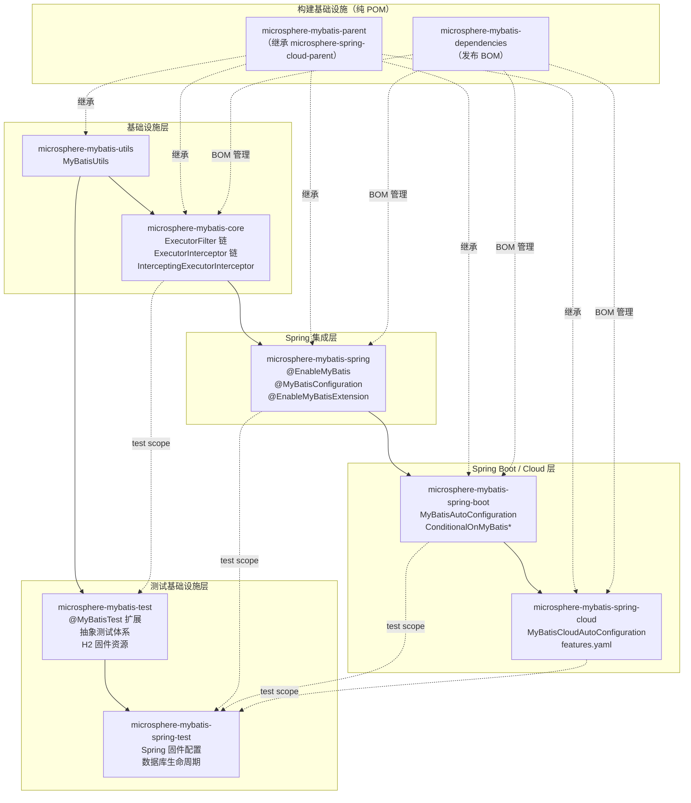
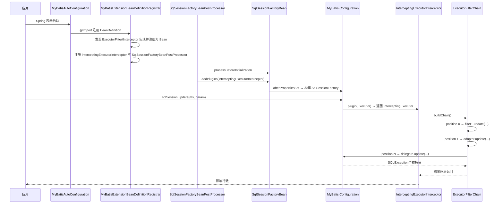

# 架构设计 —— Microsphere MyBatis 0.2.x（`current`）

[English](../architecture.md) · [← 开发者文档索引](../../README.md) · [1.x](../../1.x/zh/architecture.md)

---

## 项目定位

Microsphere MyBatis 位于 MyBatis 框架与 Spring 容器**之间**。它不替代 MyBatis，而是在
MyBatis 的 `Executor` 接口之上增加一个可观测、可组合的扩展层，再把该层接入 Spring 的
Bean 生命周期。

```
┌──────────────────────────────────────────────────────────┐
│  应用（你的代码）  @SpringBootApplication  @Bean ExecutorFilter │
├──────────────────────────────────────────────────────────┤
│  microsphere-mybatis-spring-cloud   （HasFeatures）      │
│  microsphere-mybatis-spring-boot    （AutoConfiguration）│
│  microsphere-mybatis-spring         （@EnableMyBatis…）  │
├──────────────────────────────────────────────────────────┤
│  microsphere-mybatis-core    Executor 过滤器/拦截器链     │
│  microsphere-mybatis-utils   引导与模板 API               │
│  microsphere-mybatis-test    JUnit 5 扩展与固件           │
│  microsphere-mybatis-spring-test  Spring 固件配置         │
├──────────────────────────────────────────────────────────┤
│  MyBatis 3.5.x  +  mybatis-spring 4.1.0（optional 依赖）  │
└──────────────────────────────────────────────────────────┘
```

---

## 模块依赖关系图（编译期，仅必需依赖）



实线 = 必需的编译期依赖；虚线 = optional / test scope / 构建期关系。

---

## 外部依赖策略

各模块 `pom.xml` 中所有第三方与上游 microsphere 依赖均声明为 **`optional`**：

- 实际解析版本由消费方自己的 BOM（`spring-boot-starter-parent`、`spring-cloud-dependencies` 等）决定；
- 避免版本锁死，可同时服务多个 Spring 代际；
- 唯一的硬编译依赖是仓库内部的模块边（如 `core → utils`、`spring → core`）。

`microsphere-mybatis-parent` 集中定义版本属性（`mybatis.version`、`mybatis-spring.version` 等），
CI 针对 `spring-cloud-2022`…`spring-cloud-2025` 只需激活对应 profile。

---

## 端到端执行流程（Spring Boot 应用）



---

## 设计原则

1. **无侵入扩展** —— 仅通过 MyBatis 插件机制（`Interceptor.plugin(target)`）接入，
   不子类化、不篡改任何 MyBatis / mybatis-spring 类。
2. **以链代代理** —— `ExecutorFilterChain` 取代 MyBatis 单代理 `Plugin` 模型，成为显式、
   可组合的链；多个 `Interceptor` 插件可共存并自动合并。
3. **可观测但零副作用** —— `ExecutorInterceptor` 回调即发即忘：
   `InterceptorsExecutorFilterAdapter.iterate()` 捕获所有 `Throwable` 并以 `warn` 记录，
   保证损坏的审计/指标回调不会影响 SQL 主链路。
4. **优先级 SPI** —— `ExecutorFilter` 与 `ExecutorInterceptor` 均继承
   `io.microsphere.lang.Prioritized`，稳定升序排序。
5. **测试先行固件** —— test 模块把 H2 配置、Mapper XML、init/destroy 脚本放入
   `src/main/resources` 随包发布，下游模块与消费方测试零配置复用。
6. **版本线分支策略** —— Java 8 线（`release-1.x`）与 Java 17 线（`release`/`main`）
   设计一致，仅语言特性与自动配置注册文件不同。

---

## 模块文档索引

| 模块 | 开发者文档 |
|---|---|
| [microsphere-mybatis-utils](utils.md) | 引导工具类、`ThrowableConsumer` 模板 |
| [microsphere-mybatis-core](core.md) | 过滤器链、适配器、`CachingExecutor` 解包 |
| [microsphere-mybatis-test](test.md) | JUnit 5 扩展生命周期、解析器依赖图 |
| [microsphere-mybatis-spring](spring.md) | 注册器家族、`SqlSessionFactoryBeanPostProcessor` |
| [microsphere-mybatis-spring-test](spring-test.md) | 事件驱动的数据库生命周期 |
| [microsphere-mybatis-spring-boot](spring-boot.md) | 自动配置排序与条件 |
| [microsphere-mybatis-spring-cloud](spring-cloud.md) | `features.yaml` 绑定、`HasFeatures` Bean |
| [parent 与 dependencies](parent-and-dependencies.md) | POM 层级、`${revision}` flatten、BOM 范围 |
