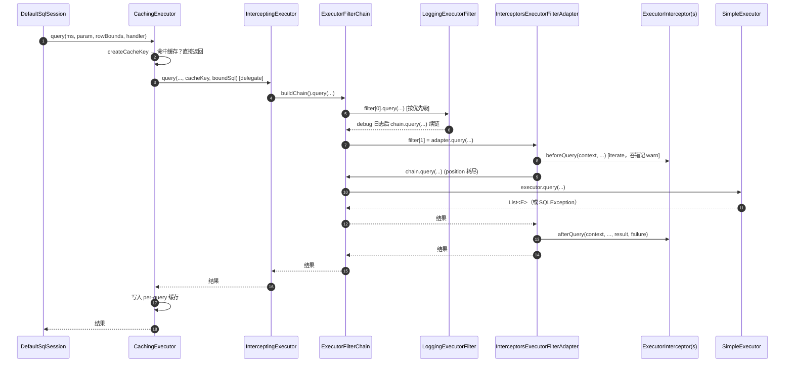

# microsphere-mybatis-core —— 开发者文档（`current`）

[English](../core.md) · [← 索引](README.md) · [用户文档](../../../user-guide/current/zh/core.md)

项目核心。三个包：`io.microsphere.mybatis.executor`、`.plugin`、`.constants`。

## 架构设计

本模块把 MyBatis 的"每个 Interceptor 一个代理"插件模型，转换为在装饰器 `Executor` 内部执行的
"显式过滤器链"，同时对 MyBatis 框架而言仍然是一个完全普通的 `Interceptor`。

```mermaid
graph LR
    subgraph MyBatis
        SS[DefaultSqlSession] --> CE[CachingExecutor]
        CE --> SE[SimpleExecutor / Reuse / Batch]
    end
    subgraph microsphere-mybatis-core
        IEI[InterceptingExecutorInterceptor\n实现 org.apache.ibatis.plugin.Interceptor]
        IE[InterceptingExecutor\n实现 Executor]
        FC[ExecutorFilterChain]
        ADP[InterceptorsExecutorFilterAdapter\n实现 ExecutorFilter]
        F1[ExecutorFilter #1]
        FN[ExecutorFilter #N]
        I1[ExecutorInterceptor #1]
        IN[ExecutorInterceptor #N]
    end
    SS -->|plugin()| IEI -->|包装| IE -->|buildChain| FC
    FC --> F1 --> FN --> ADP --> SE
    ADP --> I1
    ADP --> IN
```

## 源码分析

### 1. 注册与包装：`InterceptingExecutorInterceptor.plugin(Object)`

`microsphere-mybatis-core/src/main/java/io/microsphere/mybatis/plugin/InterceptingExecutorInterceptor.java:134`

```java
if (target instanceof Executor executor) {
    boolean isCachingExecutor = executor instanceof CachingExecutor;
    Executor delegate = isCachingExecutor
        ? getDelegate((CachingExecutor) executor)   // 反射读取 CachingExecutor#delegate
        : executor;
    ...
    if (delegate instanceof InterceptingExecutor previous) {
        delegate = previous.getDelegate();                       // 解开旧包装
        // 把已有 filters + properties 合并进新集合               // 重复注册保持幂等
    }
    InterceptingExecutor interceptingExecutor = new InterceptingExecutor(delegate, newProperties, executorFilters);
    return isCachingExecutor ? new CachingExecutor(interceptingExecutor) : interceptingExecutor;
}
return target;   // ParameterHandler/ResultSetHandler/StatementHandler 原样透传
```

为什么要解开 `CachingExecutor`：MyBatis 构建 `CachingExecutor(SimpleExecutor(...))` 后由外而内
应用插件。若过滤器位于缓存之外，命中缓存的查询永远不会经过它们。解包后
`InterceptingExecutor` 位于**缓存与真实执行器之间**，过滤器只观察未命中缓存的真实执行。

`intercept(Invocation)` 刻意不做任何事（warn + `proceed()`）：全部工作在 `plugin()` 完成，
因此无需 `@Intercepts`/`@Signature` 注解，也永远不会进入 JDK 代理 `Plugin` 路径。

构造器（`:80`）把 `ExecutorInterceptor...` 合并为单个适配器元素追加到过滤器数组，
随后整数组按 `PriorityComparator`（`Prioritized#getPriority` 升序）排序。

### 2. 装饰器：`InterceptingExecutor`

`executor/InterceptingExecutor.java:60` 以委托方式实现 `Executor`：

- 受过滤操作（`update`、两个 `query`、`queryCursor`、`commit`、`rollback`、`createCacheKey`、
  `deferLoad`、`getTransaction`、`close`）每次调用都 `buildChain()` 新建 **全新的**
  `ExecutorFilterChain`，保证链可重入、无状态。
- 不受过滤操作（`flushStatements`、`isCached`、`clearLocalCache`、`isClosed`）直接委托 ——
  热缓存路径零链开销。
- `setExecutorWrapper(Executor)` 用当前实例的 properties 与 filters 重新包装新内层执行器
  （防重复包装），保证 MyBatis `BaseExecutor` 重建 wrapper 时链不丢失。

### 3. 链机制：`ExecutorFilterChain.process(...)`

`executor/ExecutorFilterChain.java:307` —— 责任链核心：

```java
if (position < size) {
    result = filterFunction.apply(filters[position++]);   // 下一个过滤器
} else {
    result = executorFunction.apply(this.executor);        // 真实 Executor
}
```

异常策略按方法族划分：

| 方法族 | 受检异常处理 |
|---|---|
| `applySQL` / `consumeSQL`（SQL 操作） | `ExceptionUtils.wrap(e, SQLException.class)` —— SQL 失败保持 `SQLException` 语义 |
| `apply` / `consume`（非 SQL 操作） | 包装为 `RuntimeException` |

可变字段 `position` 之所以安全，是因为每次调用都会新建链实例。

### 4. 适配器与错误隔离：`InterceptorsExecutorFilterAdapter`

`executor/InterceptorsExecutorFilterAdapter.java:65` 实现 `ExecutorFilter`，每个方法同构
（以 `update` 为例，`:92`）：

```java
InterceptorContext<Executor> context = buildContext(chain);
beforeUpdate(context, ms, parameter);
try {
    result = chain.update(ms, parameter);
} catch (SQLException e) {
    failure = e; throw e;
} finally {
    afterUpdate(context, ms, parameter, result, failure);
}
```

- `buildContext` = `new InterceptorContext<>(chain.getExecutor(), chain.getProperties())` ——
  每个**操作**一个上下文，被该操作的全部拦截器共享（属性可互相传递；计时状态各自新建）。
- `iterate(Consumer)`（`:338`）把每个拦截器回调包进 try/catch `Throwable` + `logger.warn` ——
  即"即发即忘"保证。
- 拦截器数组在构造时按优先级排序（`:88`）。

### 5. 签名工具：`Plugins`

`plugin/Plugins.java` 重新实现 MyBatis 的 `Plugin.getSignatureMap` 并**更严格校验**：
`@Signature#type` 超出 `{Executor, ParameterHandler, ResultSetHandler, StatementHandler}`
直接抛 `PluginException`（`:112`）；`getPlugin(proxy)`（`:133`）通过检查 `InvocationHandler`
是否为 `Plugin` 来识别 MyBatis 的 JDK 代理。0.2.x 线使用 `Map#computeIfAbsent`，
1.x 线使用 MyBatis 内部的 `MapUtil.computeIfAbsent` —— 这是两分支仅有的实质代码差异之一。

### 6. 常量：`PropertyConstants`

定义 `microsphere.mybatis.enabled`（`:64`），标注
`@ConfigurationProperty(type = boolean.class, defaultValue = "true", source = APPLICATION_SOURCE)`，
被 Spring Boot 模块的 `@ConditionalOnProperty` 消费，并可导出 IDE 元数据。

## 复杂流程：一次 `sqlSession.selectList(...)` 穿越各层



## 设计模式

| 模式 | 类 | 说明 |
|---|---|---|
| 责任链 | `ExecutorFilterChain` + `ExecutorFilter` | 下标游标链，每次调用新建实例 |
| 装饰器 | `InterceptingExecutor` | 为任意 `Executor` 叠加链行为且不改变类型 |
| 适配器 | `InterceptorsExecutorFilterAdapter` | N 个拦截器 → 1 个过滤器；桥接两种扩展风格 |
| 观察者（成对回调） | `ExecutorInterceptor` | `beforeXxx`/`afterXxx` 携带 result+failure |
| 代理（框架侧） | MyBatis `Plugin` | 刻意绕开 —— `plugin()` 返回具体装饰器而非 JDK 代理 |
| 享元式上下文 | `InterceptorContext` | 每操作一个，跨拦截器共享 |
| 模板方法 | `ExecutorFilterChain.apply/consume(…SQL)` 方法族 | 固定异常策略，lambda 可插拔 |
| 策略 | 每次注册的过滤器数组 | 组合决定行为，按 `Prioritized` 排序 |

## 测试策略

`core` 模块测试（`InterceptingExecutorInterceptorTest` 等）继承 test 模块的
`AbstractMapperTest` —— 真实 H2 执行、零 mock。负向用例使用
`ThrowingErrorExecutorFilter/Interceptor` + `runSafely(...)`，验证错误隔离承诺：
`Executor` 操作自身的 `SQLException` 必须照常上抛，而拦截器失败全部被吞掉。

## 另见

- [spring 模块解析](spring.md) —— 插件如何进入 Spring 构建的工厂
- [test 模块解析](test.md)
- [1.x 差异](../../1.x/zh/core.md)
