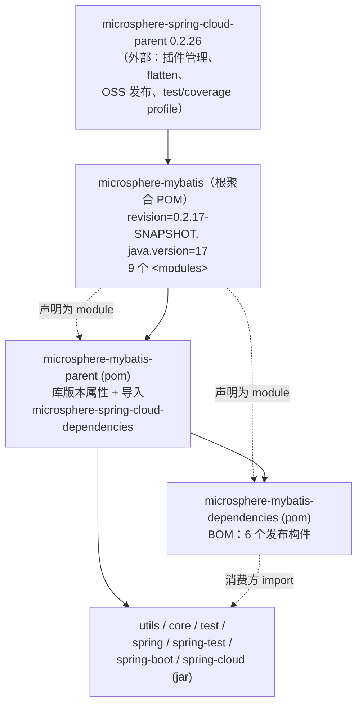
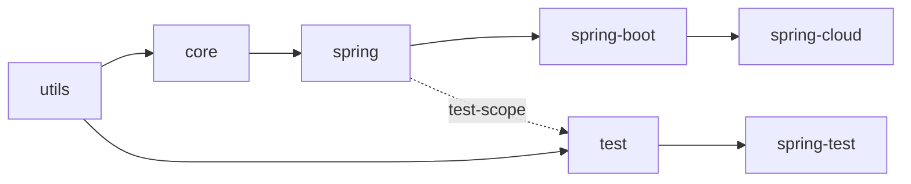

# Parent 与 Dependencies POM —— 开发者文档（`current`）

[English](../parent-and-dependencies.md) · [← 索引](README.md) · [用户文档](../../../user-guide/current/zh/parent-and-dependencies.md)

三个非代码 POM 支撑着整个构建：根聚合 POM、内部父 POM（`microsphere-mybatis-parent`）、
对外发布的 BOM（`microsphere-mybatis-dependencies`）。

## POM 继承关系

源自 POM 的关键事实：

- 根 POM 的**唯一**父级是 `microsphere-spring-cloud-parent`（跨仓库的外部父 POM）。
  构建插件、发布配置以及 `test` / `coverage` / `spring-cloud-*` Maven profile 全部来自
  那里 —— 本仓库自身没有定义任何这些内容。
- `microsphere-mybatis-parent` 是所有 jar 模块**以及** BOM 的父 POM；它锁定库的代际：

  | 属性 | 值 |
  |---|---|
  | `microsphere-spring-cloud.version` | `0.2.26`（以 `microsphere-spring-cloud-dependencies` BOM 导入） |
  | `mybatis.version` | `3.5.19` |
  | `mybatis-spring.version` | `4.1.0` |
  | `mybatis-spring-boot.version` | `3.0.5`（starter） |
  | `cglib.version` | `3.3.0` |

- 版本处处使用 `${revision}`，只在根 POM 定义一次（`release` 分支上为 `0.2.17-SNAPSHOT`）。
  外部父 POM 应用了 **flatten-maven-plugin**，因此发布的 POM 会把 `${revision}`（以及导入的
  BOM）解析成具体值 —— CI 用 `-Drevision=0.0.1-SNAPSHOT` 覆盖以避免发布冲突。

## 内部模块依赖链

- 编译边即硬依赖链：`utils → core → spring → spring-boot → spring-cloud` 与
  `utils → test → spring-test`。
- **每个模块中的每个上游库依赖都是 `<optional>true</optional>`**（MyBatis、
  mybatis-spring、Spring、Spring Boot、Spring Cloud、microsphere-spring-*）。消费方必须
  自带 MyBatis/Spring 版本；不会被强制传递拉取任何依赖。
- 内部依赖边使用 `<version>${revision}</version>` 而非导入 BOM —— BOM 是给第三方消费方
  用的，不是给 reactor 构建用的。

## BOM 范围缺口

`microsphere-mybatis-dependencies` 恰好管理六个构件：`core`、`test`、`spring`、
`spring-test`、`spring-boot`、`spring-cloud`。

**`microsphere-mybatis-utils` 不在 BOM 中**，因此 import 该 BOM 并依赖 utils 的消费方
必须写显式版本号。（已对照 `release` 分支的 POM 核实；按缺口看待，而非设计决策。）

## CI 矩阵

`.github/workflows/maven-build.yml` 在 `main`/`dev`/`release` 推送时以如下矩阵构建 reactor：

- `java: [17, 21, 25]`（temurin）
- `maven-profile-spring-cloud: [spring-cloud-2022, spring-cloud-2023, spring-cloud-2024, spring-cloud-2025]`
  —— 即 3 × 4 = 12 种组合，每种执行 `mvn --activate-profiles test,coverage,<profile>
  -Drevision=0.0.1-SNAPSHOT`。

这就是[用户文档](../../../user-guide/zh/README.md)中兼容性范围（0.2.x 支持
Spring Cloud 2022.0.x – 2025.0.x）的强制性佐证。

## 另见

- [架构总览](architecture.md) —— 模块职责
- [1.x 差异](../../1.x/zh/parent-and-dependencies.md) —— 0.1.x 的 POM 代际（Java 8、mybatis-spring 2.1.2）
