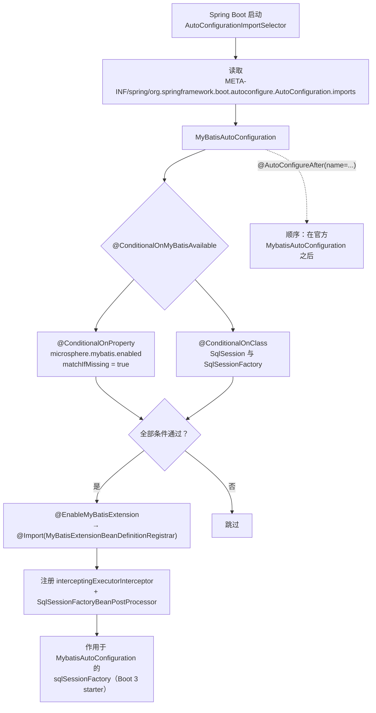

# microsphere-mybatis-spring-boot —— 开发者文档（`current`）

[English](../spring-boot.md) · [← 索引](README.md) · [用户文档](../../../user-guide/current/zh/spring-boot.md)

共三个类：一个空的自动配置外壳，两个组合条件注解。所有实际工作都委托给
[spring 模块](spring.md)。

## 架构设计



## 源码分析

### `MyBatisAutoConfiguration`

```java
@ConditionalOnMyBatisAvailable
@EnableMyBatisExtension
@AutoConfigureAfter(name = {"org.mybatis.spring.boot.autoconfigure.MybatisAutoConfiguration"})
public class MyBatisAutoConfiguration { }
```

- **空类体。** 出现在 `AutoConfiguration.imports` 中即使其成为配置类；真正注册
  注册器（registrar）的是 `@EnableMyBatisExtension` 的元 `@Import`。
- `@AutoConfigureAfter` 使用的是 **`name`** 属性（字符串类名），因此即使
  `mybatis-spring-boot-autoconfigure` 不在 classpath 上，该类也能编译和运行 ——
  它只是经由条件判断变成空操作。若用 `value` 就会产生硬编译依赖。
- 顺序很重要：官方的 `MybatisAutoConfiguration` 创建 `sqlSessionFactory`；我们的
  `BeanPostProcessor` 必须**先于**该 bean 初始化完成注册，插件才能在其
  `SqlSessionFactoryBean#plugins` 里、`afterPropertiesSet` 之前就位。
  `@AutoConfigureAfter` 保证自动配置阶段的顺序，其余由上下文刷新内的后处理器顺序保障。

### 条件注解

```java
@ConditionalOnMyBatisEnabled                        // @ConditionalOnProperty(name = MICROSPHERE_MYBATIS_ENABLED_PROPERTY_NAME, matchIfMissing = true)
@ConditionalOnClass(name = {"org.apache.ibatis.session.SqlSession",
                            "org.apache.ibatis.session.SqlSessionFactory"})
public @interface ConditionalOnMyBatisAvailable { }
```

两者都是**组合注解**（元注解），这是 Spring Boot 久经考验的惯用法，让
`@Conditional...` 保持声明式且可复用。属性名常量来自
`io.microsphere.mybatis.constants.PropertyConstants`（core 模块）——
与 spring-cloud 模块共享的唯一事实源。

`matchIfMissing = true` ⇒ 默认开启；`ConditionalOnMyBatisEnabledTest` 把两个方向都锁定。

### 测试架构

`MyBatisAutoConfigurationTest extends AutoConfigurationTest<MyBatisAutoConfiguration>`
（microsphere-spring-boot-test）—— 一个外部基类，自带三个继承测试
（正常自动配置 / 全局禁用 / 类缺失），子类通过覆盖
`configureAutoConfiguredClasses`、`configureGlobalDisabledPropertyValues`、
`configureGlobalMissingClasses` 来参数化。本模块的覆盖实现把
`InterceptingExecutorInterceptor.class` 加入期望的源注册类集合 ——
这是对注册器输出的契约测试。

## 设计模式

| 模式 | 位置 |
|---|---|
| 组合条件 | `@ConditionalOnMyBatisAvailable` = Enabled ∧ OnClass |
| 自动配置 + 顺序约束 | `AutoConfiguration.imports` + `@AutoConfigureAfter(name=…)` |
| 空对象外壳 | 空配置类 —— 行为完全来自元注解 |
| 契约测试基类 | `AutoConfigurationTest<T>` 模板 |

## 已知局限

- 只自动配置了 Executor 扩展；`sqlSessionFactory`/`sqlSessionTemplate` 仍归官方 starter
  负责（有意为之，避免配置命名空间冲突）。
- 不存在 `@ConfigurationProperties` 类；`microsphere.mybatis.enabled` 是唯一的开关 ——
  定制通过声明 filter/interceptor bean 完成。

## 另见

- [spring-cloud 源码分析](spring-cloud.md) —— 依赖本模块
- [1.x 差异](../../1.x/zh/spring-boot.md) —— `spring.factories` 注册
