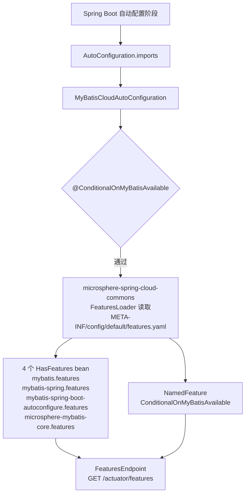

# microsphere-mybatis-spring-cloud —— 开发者文档（`current`）

[English](../spring-cloud.md) · [← 索引](README.md) · [用户文档](../../../user-guide/current/zh/spring-cloud.md)

依赖链的可观测性末端：一个空的自动配置类，唯一职责是激活一个静态 `features.yaml`，
让 MyBatis 技术栈出现在 Spring Cloud 的 `/actuator/features` 端点里。

## 架构设计



与 [spring-boot 模块](spring-boot.md) 不同，这个自动配置类**没有
`@EnableMyBatisExtension`** —— 不注册任何功能 bean。它的一切"行为"都是声明式元数据，
通过 classpath 资源发布。

## 源码分析

### `MyBatisCloudAutoConfiguration`

```java
@ConditionalOnMyBatisAvailable
@AutoConfigureAfter(name = {"org.mybatis.spring.boot.autoconfigure.MybatisAutoConfiguration"})
public class MyBatisCloudAutoConfiguration { }
```

- 复用 spring-boot 模块的 `@ConditionalOnMyBatisAvailable`，因此同一个开关
  （`microsphere.mybatis.enabled`，默认 `true`）能同时关闭 Executor 扩展与特性发布。
- `@AutoConfigureAfter(name=…)` 的顺序约束与 boot 模块一致，同样用字符串 `name`
  避免对 optional 的 MyBatis starter 产生编译依赖。

### `META-INF/config/default/features.yaml`

该文件由 microsphere-spring-cloud 的特性基础设施消费（运行期需
`spring.cloud.features.enabled=true`）。分两节：

- **`abstract:`** 四组类名，每组生成一个 `HasFeatures` bean —— 只有当组内类位于
  classpath 时才会报告该组：

  | 分组 | 条目数 | 内容 |
  |---|---|---|
  | `mybatis` | 19 | 核心 SPI 类型：`Executor`、`Interceptor`、`TypeHandler`、`LanguageDriver`、`DatabaseIdProvider`、`DataSourceFactory`、`SqlSessionFactory`、`TransactionFactory`、`Configuration`、`Cache`、`KeyGenerator`、`ProxyFactory`、`ParameterHandler`、`ResultContext`、`ResultSetHandler`、`StatementHandler`、`ResultHandler`、`SqlSource`、`ReflectorFactory` |
  | `mybatis-spring` | 6 | `SqlSessionTemplate`、`MapperFactoryBean`、`MapperScannerConfigurer`、`MapperScannerBeanDefinitionParser`、`SqlSessionFactoryBean`、`SpringManagedTransactionFactory` |
  | `mybatis-spring-boot-autoconfigure` | 3 | `MybatisProperties`、`ConfigurationCustomizer`、`SqlSessionFactoryBeanCustomizer` |
  | `microsphere-mybatis-core` | 2 | `ExecutorFilter`、`ExecutorInterceptor` |

- **`named:`** 一个 `NamedFeature`（`ConditionalOnMyBatisAvailable` → 其注解类型），
  把该条件作为具名特性条目暴露出来。

`microsphere-mybatis-core` 组最有意思：它报告的是本项目自己的扩展 SPI，运维人员由此
可以确认过滤/拦截栈确实已部署。

### POM 依赖形态

所有上游依赖均为 `optional`（`microsphere-spring-cloud-commons`、
`spring-cloud-commons`、`spring-boot-starter`、actuator、各 MyBatis 构件）。
编译期链条恰好只有一条边：`microsphere-mybatis-spring-boot`。

## 测试

两层：

- `MyBatisCloudAutoConfigurationTest extends AutoConfigurationTest<…>` —— 条件的契约
  测试：不期望任何自动配置类（空类体）、以 `microsphere.mybatis.enabled=false` 全局禁用、
  缺失类 `SqlSession`/`SqlSessionFactory`。
- `MyBatisCloudAutoConfigurationIntegrationTest` —— 真实的 `@SpringBootTest` 配合
  `@EnableAutoConfiguration` 与 `spring.cloud.features.enabled=true`；断言四个
  `HasFeatures` bean（`mybatis.features`、`mybatis-spring.features`、
  `mybatis-spring-boot-autoconfigure.features`、`microsphere-mybatis-core.features`），
  以及 `FeaturesEndpoint#features()` 返回非空负载。它还把 `LoggingExecutorFilter` /
  `LoggingExecutorInterceptor` 注册为 bean，从而端到端地演练 spring 模块的扩展路径。

## 设计模式

| 模式 | 位置 |
|---|---|
| 声明式元数据优于代码 | 整个模块：一个 YAML 文件取代一切特性注册逻辑 |
| 组合条件复用 | `@ConditionalOnMyBatisAvailable` 与 spring-boot 模块共享 |
| classpath 自省报告 | `HasFeatures` 分组按类的存在性门控 |

## 已知局限

- `microsphere-mybatis-spring-test` 在本模块 pom 中**没有声明 `<scope>test</scope>`**，
  因此会作为 compile 作用域的传递依赖泄漏给消费方。功能上没问题（集成测试依赖它），但
  看起来并非有意 —— 消费方应自行 exclude 或锁定自己的版本。
- 特性是静态的：新增分组意味着修改 `features.yaml`，而不是扩展代码。

## 另见

- [spring-boot 源码分析](spring-boot.md) —— 共享条件注解所在地
- [parent 与 dependencies](parent-and-dependencies.md) —— optional 依赖策略如何落实
- [1.x 差异](../../1.x/zh/spring-cloud.md) —— `spring.factories` 注册
