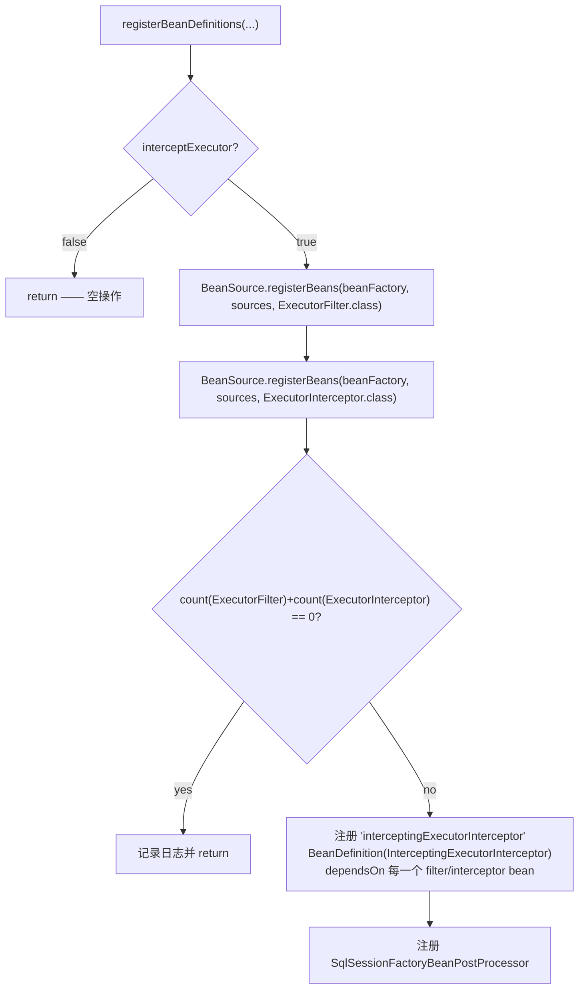

# microsphere-mybatis-spring —— 开发者文档（`current`）

[English](../spring.md) · [← 索引](README.md) · [用户文档](../../../user-guide/current/zh/spring.md)

八个类、一个包（`io.microsphere.mybatis.spring.annotation`）：三个注解 + 一个注册器家族 +
一个 Bean 后处理器。本模块把注解属性翻译为 Spring `BeanDefinition` —— 解析阶段不实例化任何 Bean。

## 架构设计

```mermaid
graph TD
    EM["@EnableMyBatis"] -->|@Import| MBDR[MyBatisBeanDefinitionRegistrar]
    EMC["@MyBatisConfiguration"] -->|@Import| MCBDR[MyBatisConfigurationBeanDefintionRegistrar]
    EME["@EnableMyBatisExtension"] -->|@Import| MEIBDR[MyBatisExtensionBeanDefinitionRegistrar]
    BASE[MyBatisImportBeanDefinitionRegistrar<A extends Annotation>\n包私有抽象基类] --> MBDR & MCBDR & MEIBDR
    ABC["AnnotatedBeanCapableImportBeanDefinitionRegistrar\n（来自 microsphere-spring-context）"] --> BASE
    MEIBDR -->|注册| IEI["bean: interceptingExecutorInterceptor"]
    MEIBDR -->|注册| BPP[SqlSessionFactoryBeanPostProcessor]
    BPP -->|addPlugins| SFB["SqlSessionFactoryBean\n（来自 @EnableMyBatis 或官方 starter）"]
    MBDR -->|注册| SF["bean: sqlSessionFactory（SqlSessionFactoryBean）"]
    MBDR -->|注册| ST["bean: sqlSessionTemplate"]
    MCBDR -->|注册| CFG["bean: configuration（MyBatis Configuration）"]
```

## 源码分析

### 1. 共享基类：`MyBatisImportBeanDefinitionRegistrar`

入口模板位于上游 microsphere-spring-context：
`registerBeanDefinitions(metadata, registry, generator)` 是 **final** 的 —— 先检查
`isEnabled(metadata)`（`microsphere.mybatis.enabled` 风格的开关），再解析
`ResolvablePlaceholderAnnotationAttributes`（注解值里的 `${...}` 在创建 Bean 定义**之前**
针对 Spring `Environment` 展开），然后调用子类的钩子。提供给子类的辅助方法：

| 辅助方法 | 行为 |
|---|---|
| `registerBeanDefinitionIfAbsent(...)` | 首次注册优先 —— 已存在 `sqlSessionFactory` bean 时跳过并打 `INFO` 日志 |
| `stringArrayToProperties(String[])` | 每个条目必须恰含一个 `=`（key/value 会 trim），否则 `IllegalArgumentException` —— 由 `InvalidConfigurationPropertiesTest` 锁定 |
| `setBeanReferencePropertyValue(...)` | 空串 ⇒ 跳过；`"*"` ⇒ `findTargetBeanName(type)`（多个时 primary 胜出）；字面量 ⇒ `RuntimeBeanReference` |
| `setPropertyValue(builder, attributes, name, default)` | 等于注解默认值的属性被跳过 ⇒ 得到精简的 bean 定义 |
| `setPackagePropertyValue(...)` | 多包用换行符拼接（MyBatis 惯例） |

### 2. `MyBatisBeanDefinitionRegistrar`（`@EnableMyBatis`）

用 `BeanDefinitionBuilder.genericBeanDefinition(SqlSessionFactoryBean.class)` 完全依据注解
属性装配（`dataSource` 引用、`configLocation` 或 `configuration` bean **引用**、
`mapperLocations`、`typeAliasesPackage`、以 `Properties` 承载的 `configurationProperties`、
以 bean 引用承载的 `plugins`/`typeHandlers`/`scriptingLanguageDrivers` 等）。当
`configLocation` 为空时，注册器改为接入注解式 `configuration` bean —— 这就是
`@MyBatisConfiguration` ↔ `@EnableMyBatis` 的互锁。`sqlSessionTemplate` 以构造参数
`(sqlSessionFactory 引用, executorType)` 注册。`checkConfigLocation=true` 会在**注册期间**
断言资源存在，在任何 bean 实例化之前快速失败。

### 3. `MyBatisConfigurationBeanDefintionRegistrar`（`@MyBatisConfiguration`）

（类名含历史拼写错误 "Defintion"；包私有，不面向用户。）
把约 34 个注解属性机械拷贝到 `Configuration` bean 定义上，附三处转换：
`lazyLoadTriggerMethods` `String[]`→`Set`、`variables` `String[]`→`Properties`、
`proxyFactory` `Class`→ **实例**（用 `RuntimeBeanValue` 会失败；实例化修复随 0.2.15 发布，
并镜像到 0.1.16）。默认值被跳过，因此 MyBatis 自身的默认值得以保留。

### 4. `MyBatisExtensionBeanDefinitionRegistrar`（`@EnableMyBatisExtension`）



`BeanSource` 语义（来自 microsphere-spring-context）：`BEAN_FACTORY` 只*查询*既有定义；
`SPRING_FACTORIES` 按接口名作 key 从 `META-INF/spring.factories` 加载**类**并注册；
`JAVA_SERVICE_PROVIDER` 通过 `ServiceLoader` 做同样的事。按类注册的 bean 获得名称生成式注册
（`BeanRegistrar` 决定是 `loggingExecutorFilter#0` 风格还是简单类名）。

### 5. `SqlSessionFactoryBeanPostProcessor`

包私有，`extends GenericBeanPostProcessorAdapter<SqlSessionFactoryBean>`，构造器注入拦截器
bean。`processBeforeInitialization`：

```java
Interceptor[] plugins = getFieldValue(true, bean, "plugins");   // 反射读取 SqlSessionFactoryBean#plugins
if (contains(plugins, this.interceptingExecutorInterceptor)) return;   // @EnableMyBatis(plugins=...) 已经覆盖
bean.addPlugins(this.interceptingExecutorInterceptor);
```

因为它运行在 `afterPropertiesSet()` **之前**，插件会参与常规的
`Configuration.addInterceptor` 展开流程，从而构建每个会话的 executor —— 一个后处理器、
所有工厂、无需修改 XML。

## 关键流程

**`@EnableMyBatis` + `@MyBatisConfiguration` 组合：** `EnableMyBatisTest` 中的 `MapperConfig2`
同时使用两者 —— `configuration` bean 定义由 `@MyBatisConfiguration` 注册器产生；
`MyBatisBeanDefinitionRegistrar` 检测到空的 `configLocation` 后发出
`<property name="configuration" ref="configuration"/>`，因此运行期接线是 bean **引用**而非拷贝。

**多数据源：** `MultipleDataSourceConfig` 测试展示 `dataSource = "*"` 会挑选 primary；
显式命名的值永远优先。

## 设计模式

| 模式 | 位置 |
|---|---|
| 注册器家族 / 每个注解一个"前置控制器" | 共享基类 + 三个具体的 `ImportBeanDefinitionRegistrar` |
| 模板方法 | 上游基类中 final 的 `registerBeanDefinitions` + 子类钩子 |
| Data Mapper（注解 → BeanDefinition） | 逐属性映射并省略默认值 |
| 占位符策略 | bean 引用的 `"*"`/空串/名称约定 |
| Bean 后处理器 | `SqlSessionFactoryBeanPostProcessor` |
| 惰性互锁 | `@MyBatisConfiguration` 与 `configLocation` 在注册期二选一，无运行期分支 |

## 测试方式

`EnableMyBatisTest` / `EnableMyBatisExtensionTest` 使用
`SpringTestUtils.testInSpringContainer`（以编程方式创建 `AnnotationConfigApplicationContext`），
覆盖 10+ 个嵌套配置类，每个锁定一种属性组合；
`src/test/resources/META-INF/spring.factories` 与 `META-INF/services/...` 夹具分别演练
两个 SPI 发现源。

## 另见

- [spring-boot 源码分析](spring-boot.md) —— 自动配置如何复用这些注册器
- [用户文档](../../../user-guide/current/zh/spring.md) —— 完整属性表
