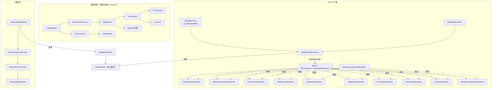
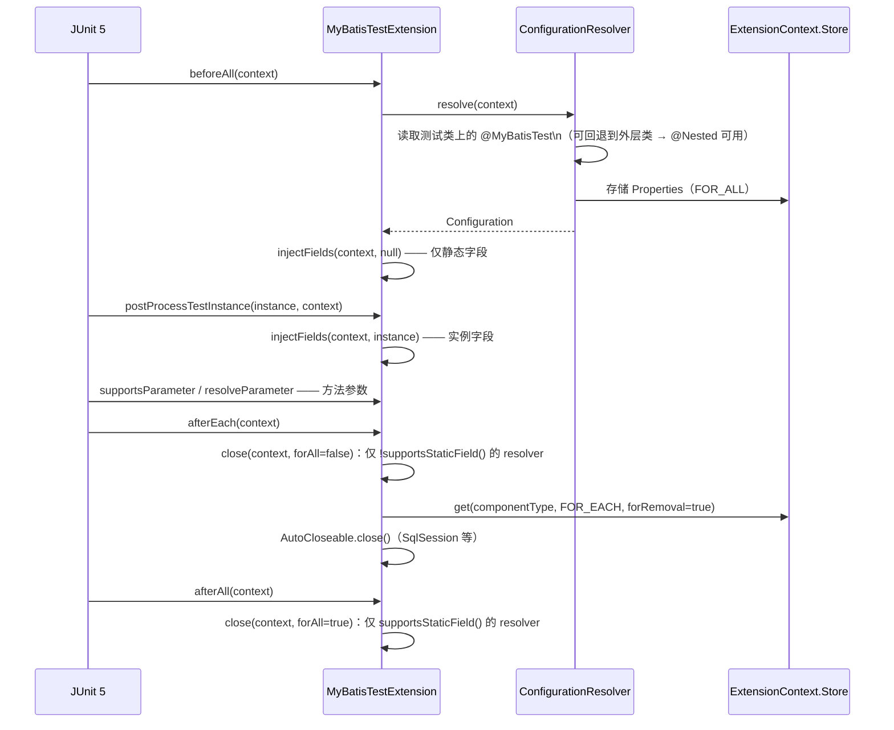

# microsphere-mybatis-test —— 开发者文档（`current`）

[English](../test.md) · [← 索引](README.md) · [用户文档](../../../user-guide/current/zh/test.md)

两个协作子系统：抽象测试继承链，以及构建在 Resolver SPI 之上的 JUnit 5 扩展。
测试夹具（config XML、Mapper、SQL 脚本）以 **main** 资源发布，因此所有下游模块与
使用者的测试均可复用。

## 架构设计



## 源码分析

### 1. 扩展生命周期（`MyBatisTestExtension.java`）

```java
public class MyBatisTestExtension implements BeforeAllCallback, AfterAllCallback,
        AfterEachCallback, TestInstancePostProcessor, ParameterResolver
```

值得注意：**没有 `BeforeEachCallback`** —— 实例字段注入搭的是
`postProcessTestInstance` 的便车，JUnit 保证每个测试实例调用一次
（`PER_CLASS` 与 `PER_METHOD` 生命周期均适用）。



注入规则（`injectFields`）：沿类层级向上收集全部声明字段（`findAllDeclaredFields`），
凡符合静态/非静态谓词、且对应 resolver 返回非 `null` 组件的字段，都用
`FieldUtils.setFieldValue(true, ...)`（强制可访问）写入。没有任何 resolver 认领的字段
保持原样 —— `String` 字段上的 `@MyBatisRuntime` 会静默地保持 `null` 而非报错
（参见 `StaticFieldTests` 对不支持的静态目标断言 `assertNull(sqlSession)`）。

### 2. Resolver SPI

`ComponentResolver<T>` —— 三个决策点：

| 方法 | 作用 |
|---|---|
| `supportsParameter(ParameterContext, ExtensionContext)` | 默认：存在 `@MyBatisRuntime` **且** `isComponentType(...)` |
| `supportsField(ExtensionContext, Field)` | 同上，另外静态字段还要求 `supportsStaticField()` |
| `resolve(ExtensionContext, Class)` | 生成（并缓存）组件 |

`AbstractComponentResolver<T>` 通过反射推导 `componentType`
（`from(getClass()).as(ComponentResolver.class).getGenericType(0)`），其 **final** 的
`resolve(...)` 实现：查 store → `doResolve(...)` → 若支持静态则写 FOR_ALL → 始终写 FOR_EACH。

缓存微妙点：`store(...)` 以 `component.getClass()`（实现类）为 key，而 `get(...)` 用
**声明类型** 查找。对接口语义的组件（`DefaultSqlSession`、`PooledDataSource`、
`JdbcTransaction`、`SimpleExecutor`、Mapper `$Proxy`）两个 key 永远不相等，因此每次查找
都会重建 —— 这正是每个测试的资源由 `afterEach` 关闭、绝不跨测试共享的原因。
`Properties`/`Configuration`/`Environment`（唯一具体类型）确实会缓存进 FOR_ALL。

`MapperComponentResolver` 是特例：`getComponentType()` 是 `Object`，它不复用等值比较而是
覆盖 `isComponentType`，查询 `Configuration#getMapperRegistry().getMappers()` ——
任何已注册的 Mapper 接口都会路由到它。

### 3. 抽象层级

`AbstractMyBatisTest.init()`（`@BeforeEach`）：
`MyBatisTestUtils.buildDefaultSqlSessionFactory()` → `customize(SqlSessionFactory)` →
`customize(Configuration)` → `runScript(INIT_DB_SCRIPT_RESOURCE_NAME)`。
`destroy()`（`@AfterEach`）执行销毁脚本。每个子类恰好新增一个 `@Test`，因此继承
`AbstractMapperTest` 会重放整个阶梯（`testSqlSession`、`testExecutor`、`testMapper`）。
`AbstractMapperTest.testMapper()` 首先调用 `getConfiguration().setCacheEnabled(false)`，
因为 `UserMapper.xml` 声明了二级缓存 `<cache/>`，否则会污染重复读取断言。

### 4. 夹具

`init-db.sql` 播入确定性数据行（father#1 `John Smith`、children#1/2），
`assertChildMapper`/`assertFatherMapper` 依赖这些数据。
`UserMapper.getErrorUserByName` **故意** 引用不存在的 `error_users` 表 ——
为拦截器链提供负路径测试（`runSafely(() -> userMapper.getErrorUserByName("testing"))`）。

## 设计模式

| 模式 | 位置 |
|---|---|
| 模板方法 | 抽象层级（`customize`、`doIn*`、继承的 `@Test` 方法） |
| 策略 + 注册表 | `ComponentResolver` 列表，按 ServiceLoader 顺序首个匹配者胜出 |
| 服务提供者（SPI） | `META-INF/services/...ComponentResolver` —— 第三方可以追加 resolver |
| 工厂方法 | `resolve`/`doResolve` 成对出现 |
| 标记注解 | `@MyBatisRuntime` |
| Object Mother | `createUser()`、实体/Mapper 夹具 |

## 扩展点

- 新增 resolver：实现 `AbstractComponentResolver<X>`，把类名追加到 services 文件
  （你自己的 jar 中的副本会通过 `ServiceLoader` 聚合）。
- 自定义夹具：声明自己的 `@MyBatisTest(configResource = "...", environment = "...")`。

## 另见

- [spring-test 源码分析](spring-test.md)
- [用户文档](../../../user-guide/current/zh/test.md) —— 属性表与使用示例
