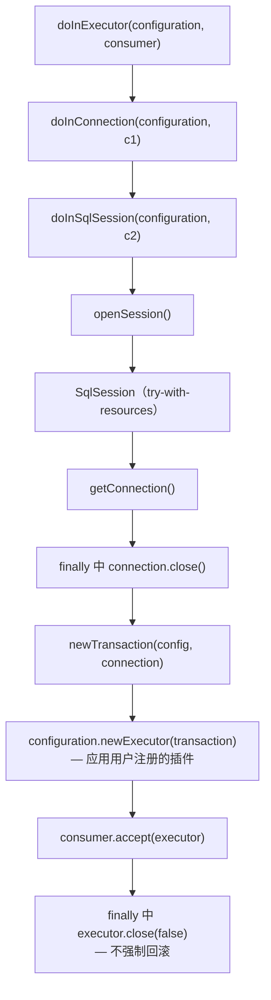

# microsphere-mybatis-utils —— 开发者文档（`current`）

[English](../utils.md) · [← 索引](README.md) · [用户文档](../../../user-guide/current/zh/utils.md)

单类模块：`io.microsphere.mybatis.util.MyBatisUtils`
（`microsphere-mybatis-utils/src/main/java/io/microsphere/mybatis/util/MyBatisUtils.java`）。

## 架构角色

全仓库最底层。它把与 MyBatis 的"第一次接触"（`XMLConfigBuilder`、`DefaultSqlSessionFactory`、
`ScriptRunner`、`TransactionFactory`）封装为无状态、异常透明的 API，使 `core`、`test` 与各
Spring 模块从不直接操作 MyBatis 构建器。

Maven：仅依赖 MyBatis（optional）与 `microsphere-java-core`（`ThrowableConsumer`、`@Nonnull`）。
BOM 不管理本构件 —— 消费方经 `core` 传递引入。

## 源码分析

### 类形态

```java
public abstract class MyBatisUtils {   // 抽象类 + 私有构造器 = 不可实例化工具类
    private MyBatisUtils() { }
}
```

采用 `abstract` 而非 `final` 是微球的统一风格（`Executors`、`Plugins`、`MyBatisTestUtils` 同型），
也为将来可能的特化留出演生余地。

### Configuration 引导

`getConfiguration(configResource, environment, properties)` 是唯一解析入口，两个短重载以 `null`
委托给它。方法把 MyBatis 的 `XMLConfigBuilder` 包进
`Resources.getResourceAsReader(...)` 的 try-with-resources：

- 资源经 MyBatis 的类加载器级联（线程上下文 → 系统 → 自身）解析；
- 即使 `parse()` 抛异常也确保 `Reader` 关闭 —— 修复手写引导代码常见泄漏点。

### 资源生命周期模板

`doInSqlSession` / `doInConnection` / `doInExecutor` 构成**分层模板栈**：



关键点：`newExecutor` 走 `Configuration#newExecutor`，因此**用户注册的 `Interceptor`
（包括 core 模块的 `InterceptingExecutorInterceptor`）会应用于此处创建的 executor**。
`doInExecutor` 因而贯穿完整插件链 —— `core`、`test` 模块的测试正是依赖这一行为。

### ScriptRunner 默认值

`runScript(DataSource, String)` 固定了：`autoCommit(true)`、`stopOnError(false)`、
`logWriter(null)`、`errorLogWriter(null)`。理由：共享的 H2 内存库中表可能已存在，
固件脚本（`init-db.sql`）允许个别语句失败；静默并继续是必需行为。

## 设计模式

| 模式 | 应用 |
|---|---|
| 静态工具类 / 伪单例 | 抽象类 + 私有构造器 |
| 模板方法（函数式变体） | `doIn*` 以 `ThrowableConsumer` 参数化 |
| 对象适配 | 把 `XMLConfigBuilder`/`ScriptRunner` 的过程式调用收敛为一次调用 |
| 异常透传 | `throws Throwable` 而非包装 —— 处置权交给调用方 |

## 约束与坑

- `getConnection(Configuration)` 按设计会泄漏其会话（文档注明"不会自动关闭"）；新代码请用 `doInConnection`。
- `doInConnection` 关闭连接但不关闭池 —— 对 `POOLED` 数据源这正是正确契约（连接归还池）。
- 所有 `throws IOException` 来自 `Resources.getResourceAsReader`；解析本身会抛 MyBatis 非受检的
  `BuilderException`。
