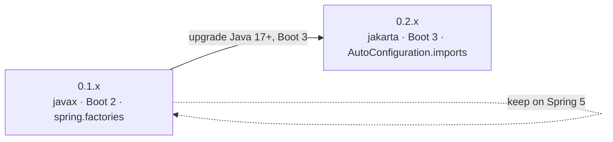

# microsphere-mybatis-parent & dependencies — User Guide (1.x / 0.1.x)

[中文](zh/parent-and-dependencies.md) · [← 1.x Index](README.md)

POM-only modules for the 0.1.x line; no Java API.

## microsphere-mybatis-parent (1.x)

| Property | Value |
|---|---|
| Parent | `microsphere-spring-cloud-parent` **0.1.26** |
| `mybatis.version` | `3.5.19` |
| `mybatis-spring.version` | **2.1.2** |
| `mybatis-spring-boot.version` (starter) | **2.1.2** |
| `cglib.version` | `3.3.0` |
| Java | 8 (CI-tested 8/11/17/21/25; no explicit `java.version` override — inherited from upstream parent) |

## microsphere-mybatis-dependencies (1.x BOM)

Manages `microsphere-mybatis-core`, `-test`, `-spring`, `-spring-test`, `-spring-boot`,
`-spring-cloud` at `0.1.16`. As on the 0.2.x line, `microsphere-mybatis-utils` is **not**
managed by the BOM.

```xml
<dependencyManagement>
    <dependencies>
        <dependency>
            <groupId>io.github.microsphere-projects</groupId>
            <artifactId>microsphere-mybatis-dependencies</artifactId>
            <version>0.1.16</version>
            <type>pom</type>
            <scope>import</scope>
        </dependency>
    </dependencies>
</dependencyManagement>
```

## Compatibility

| microsphere-mybatis 0.1.x | Requirement |
|---|---|
| Java | 8+ |
| Spring Boot | 2.x (2.1 – 2.7 era) |
| Spring Cloud | Hoxton.SR* – 2021.0.x |
| MyBatis / MyBatis-Spring / starter | 3.5.19 / 2.1.2 / 2.1.2 |
| Upstream BOM | microsphere-spring-cloud 0.1.26 |

## Migration Path



The Java API is source-compatible: the same imports work; only the artifact line changes.
