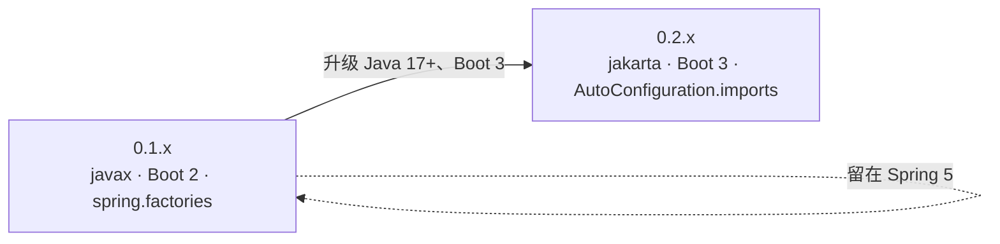

# microsphere-mybatis-parent 与 dependencies —— 用户文档（1.x / 0.1.x）

[English](../parent-and-dependencies.md) · [← 1.x 索引](README.md)

0.1.x 线的纯 POM 模块，无 Java API。

## microsphere-mybatis-parent（1.x）

| 属性 | 值 |
|---|---|
| 父 POM | `microsphere-spring-cloud-parent` **0.1.26** |
| `mybatis.version` | `3.5.19` |
| `mybatis-spring.version` | **2.1.2** |
| `mybatis-spring-boot.version`（starter） | **2.1.2** |
| `cglib.version` | `3.3.0` |
| Java | 8（CI 验证 8/11/17/21/25；无显式 `java.version` 覆盖，继承上游父 POM） |

## microsphere-mybatis-dependencies（1.x BOM）

以 `0.1.16` 管理 `microsphere-mybatis-core`、`-test`、`-spring`、`-spring-test`、`-spring-boot`、
`-spring-cloud`。与 0.2.x 线一样，BOM **不管理** `microsphere-mybatis-utils`。

```xml
<dependencyManagement>
    <dependencies>
        <dependency>
            <groupId>io.github.microsphere-projects</groupId>
            <artifactId>microsphere-mybatis-dependencies</artifactId>
            <version>0.1.16</version>
            <type>pom</type>
            <scope>import</scope>
        </dependency>
    </dependencies>
</dependencyManagement>
```

## 版本兼容性

| microsphere-mybatis 0.1.x | 要求 |
|---|---|
| Java | 8+ |
| Spring Boot | 2.x（2.1 – 2.7 时代） |
| Spring Cloud | Hoxton.SR* – 2021.0.x |
| MyBatis / MyBatis-Spring / starter | 3.5.19 / 2.1.2 / 2.1.2 |
| 上游 BOM | microsphere-spring-cloud 0.1.26 |

## 升级路径



Java API 源码兼容：import 不变，只需切换构件版本线。
