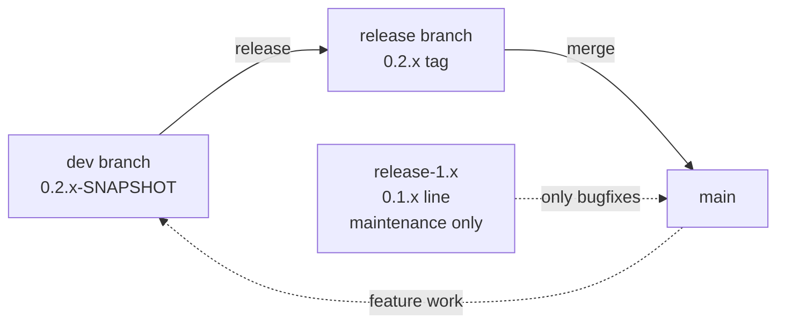

# microsphere-mybatis-parent & microsphere-mybatis-dependencies — User Guide

[中文](zh/parent-and-dependencies.md) · [← Index](../README.md)

Two POM-only modules that carry version management. They contain no Java API.

## microsphere-mybatis-parent

| Item | Value |
|---|---|
| Artifact | `io.github.microsphere-projects:microsphere-mybatis-parent` (`packaging=pom`) |
| Role | Inherited parent of every jar module in this repository; centralises third-party versions and dependency management |
| Parent | `microsphere-spring-cloud-parent` **0.2.26** (external, supplies Spring/Spring Boot/JUnit versions and build plugins) |

Managed properties (0.2.x line, release 0.2.16):

| Property | Value |
|---|---|
| `mybatis.version` | `3.5.19` |
| `mybatis-spring.version` | `4.1.0` |
| `mybatis-spring-boot.version` (starter) | `3.0.5` |
| `cglib.version` | `3.3.0` |
| `microsphere-spring-cloud.version` (imported BOM) | `0.2.26` |

Use it as your application's parent **only if** you want to inherit the whole microsphere build
conventions. Ordinary consumers should prefer the BOM below.

## microsphere-mybatis-dependencies (BOM)

| Item | Value |
|---|---|
| Artifact | `io.github.microsphere-projects:microsphere-mybatis-dependencies` (`packaging=pom`) |
| Managed artifacts | `microsphere-mybatis-core`, `-test`, `-spring`, `-spring-test`, `-spring-boot`, `-spring-cloud` (all at `${revision}`) |
| **Not managed** | `microsphere-mybatis-utils` — declare its version explicitly when used directly |

### Maven usage

```xml
<dependencyManagement>
    <dependencies>
        <dependency>
            <groupId>io.github.microsphere-projects</groupId>
            <artifactId>microsphere-mybatis-dependencies</artifactId>
            <version>0.2.16</version>
            <type>pom</type>
            <scope>import</scope>
        </dependency>
    </dependencies>
</dependencyManagement>
```

### Gradle usage

```kotlin
implementation(platform("io.github.microsphere-projects:microsphere-mybatis-dependencies:0.2.16"))
```

## Version Compatibility

The 0.2.x line (BOM `0.2.16`) requires:

- Java **17** minimum (CI-tested on 17 / 21 / 25)
- Spring Boot 3.x era and Spring Cloud **2022.0.x – 2025.0.x** (see the
  [compatibility matrix](../README.md#compatibility-matrix))

For Java 8 / Spring Boot 2.x / Spring Cloud Hoxton – 2021.0.x, use the
[1.x BOM](../1.x/parent-and-dependencies.md) instead.

## Release Flow (branch model)



`main` and `release` are kept in sync by a `sync-branches-from-upstream` workflow; published
versions follow semver-like `${revision}` bumps (patch after each publish).
