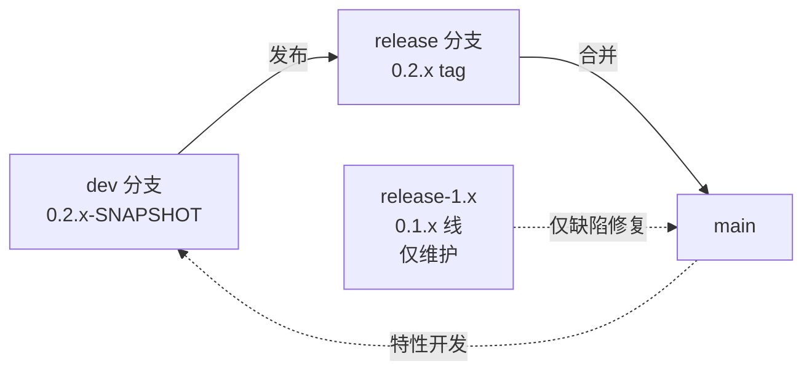

# microsphere-mybatis-parent 与 microsphere-mybatis-dependencies —— 用户文档

[English](../parent-and-dependencies.md) · [← 索引](README.md)

两个纯 POM 模块，承担版本管理职责，不含任何 Java API。

## microsphere-mybatis-parent

| 项目 | 值 |
|---|---|
| 构件 | `io.github.microsphere-projects:microsphere-mybatis-parent`（`packaging=pom`） |
| 角色 | 本仓库所有 jar 模块的继承型父 POM；集中管理第三方版本与依赖管理 |
| 其父 POM | `microsphere-spring-cloud-parent` **0.2.26**（外部，提供 Spring/Spring Boot/JUnit 版本与构建插件） |

管理的属性（0.2.x 线，release 0.2.16）：

| 属性 | 值 |
|---|---|
| `mybatis.version` | `3.5.19` |
| `mybatis-spring.version` | `4.1.0` |
| `mybatis-spring-boot.version`（starter） | `3.0.5` |
| `cglib.version` | `3.3.0` |
| `microsphere-spring-cloud.version`（导入的 BOM） | `0.2.26` |

仅当你希望继承完整的微球构建约定时才把它作为应用父 POM；
普通使用者应优先使用下面的 BOM。

## microsphere-mybatis-dependencies（BOM）

| 项目 | 值 |
|---|---|
| 构件 | `io.github.microsphere-projects:microsphere-mybatis-dependencies`（`packaging=pom`） |
| 管理的构件 | `microsphere-mybatis-core`、`-test`、`-spring`、`-spring-test`、`-spring-boot`、`-spring-cloud`（均为 `${revision}`） |
| **未管理** | `microsphere-mybatis-utils` —— 直接使用时需显式声明版本 |

### Maven 用法

```xml
<dependencyManagement>
    <dependencies>
        <dependency>
            <groupId>io.github.microsphere-projects</groupId>
            <artifactId>microsphere-mybatis-dependencies</artifactId>
            <version>0.2.16</version>
            <type>pom</type>
            <scope>import</scope>
        </dependency>
    </dependencies>
</dependencyManagement>
```

### Gradle 用法

```kotlin
implementation(platform("io.github.microsphere-projects:microsphere-mybatis-dependencies:0.2.16"))
```

## 版本兼容性

0.2.x 线（BOM `0.2.16`）要求：

- Java **17** 起步（CI 验证 17 / 21 / 25）
- Spring Boot 3.x 时代、Spring Cloud **2022.0.x – 2025.0.x**（见[兼容矩阵](../../zh/README.md#版本兼容矩阵)）

Java 8 / Spring Boot 2.x / Spring Cloud Hoxton – 2021.0.x 环境请使用
[1.x BOM](../../1.x/zh/parent-and-dependencies.md)。

## 发布流程（分支模型）



`main` 与 `release` 由 `sync-branches-from-upstream` 工作流保持同步；
发布版本遵循类 semver 的 `${revision}` 递增（每次发布后 bump patch）。
